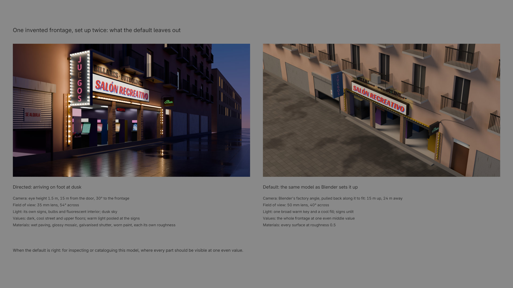

# Art direction and visual diagnosis

## A reference is an explanation to uncover

An image bundles subject, lens, pose, illumination, grading and composition.
Copying its colours while changing those relationships can lose its effect.
Distinguish the property that defines the commission from the technique that
happened to express it in the reference. An exact ceramic glaze may need a
controlled material reference; a lonely landscape may depend more on spatial
intervals and scale than on matching a particular hue.

Read subject references for evidence that changes the design. Fabrication
reveals seams, wall sections, edge treatments and repeated dimensions. Use
reveals access, support, reach and the grouping of controls. Place and period
can explain available materials, lettering, additions and exposure; handling
can explain localized polish, repairs or deposits. Keep an observed feature
separate from an imagined explanation for it. A fictional world can invent its
causes, while a measured replica has to preserve the real ones relevant to the
commission. A new object can be particular without any wear.

Look for a visual proposition specific enough to make choices: a compressed
body with a long hesitant reach; soft terrain interrupted by one severe cut;
a dense apparatus surrounding a clear working centre. Such a proposition can
guide modelling, light and animation together. A list of adjectives such as
premium, cinematic and detailed cannot resolve their conflicts.

When the direction is uncertain, compare materially different arrangements of
the same subject. Change mass, viewpoint or distribution of contrast, rather
than generating near-identical decorated variants. A rough study is useful when
it exposes the choice; it is misleading when its absent material or movement
is the very thing being decided.

For construction against a chosen frame, the
[reference-to-scene study](reference-to-scene-study.md) connects a camera-image
reference, editable masses and projected placement to actual rendered contrasts.
It also changes the commission to an additional view, where a one-view solution
no longer suffices. Use it for this translation problem, not to turn every mood
reference into a contour-matching obligation.

## Translate evidence into a committed direction

These examples show how evidence changes the choices; none is a look to
transplant to other subjects. The manifold and the bird are hypothetical
briefs. The frontage is a bundled study, built twice so the directed render
and Blender's default arrangement can be compared on the same model.

### An unhandled manifold, not distressed machinery

Suppose the drawing and process information distinguish a cast body, a cluster
of bored ports and faced mounting surfaces. Make that relationship the subject:
one continuous mass feeding the precise port group. Preserve port spacing and
fits. Put the camera just high enough to show the port mouths and their depth,
with a broad reflection turning across the cast body and a sharper boundary at
the faced surface. Keep the palette close to the actual substances and markings.
The as-made casting texture and machined finish differ at their own scales;
scratches would add a history this brief does not contain.

In the plan and first rough render, ask whether changing only the label would
make this an unrelated enclosure. If so, check whether the port grouping,
negative spaces and finish boundaries actually carry the reading. When the job
is instead a standardized catalogue comparison, a shared camera and lighting
rig can be the correct way to expose those differences. A cutaway explaining
flow needs a different view and representation from either beauty shot.

### A crowded “SALÓN RECREATIVO” frontage, directed and default

The frontage is invented and documents no real place: the arcade, its street
and its history of refits were made up for this study from what seaside
arcades of this kind accumulate. The same model is rendered twice, once
directed and once in the arrangement Blender offers before anyone decides.

[Directed render](../assets/arcade-frontage-study/directed.jpg) ·
[default render](../assets/arcade-frontage-study/default.jpg) ·
[native scenes](../assets/arcade-frontage-study/arcade-frontage-study.blend) ·
[build script](../scripts/build_arcade_frontage_study.py) ·
[sources, licences and render settings](../assets/arcade-frontage-study/SOURCE.md)

What was collected from the kind of place: sign bands added over decades and
never taken down, each in the lettering and light of its decade; failures
nobody repairs; wet promenade paving after rain; a neighbouring unit closed
with its shutter left half down; balconied flats above the ground floor. The
model carries them as particulars, not texture. A 1958 sign-writer's panel,
BILLARES · FUTBOLINES, still has its gooseneck lamps. A 1972 blade sign spells
JUEGOS in pink tube inside a border of bulbs. A 1986 backlit lightbox,
SALÓN RECREATIVO, is screwed over the lower edge of the painted panel. A 1994
bulb run frames the opening, a 2015 LED board says ABIERTO and a later neon
"Bar" hangs on the far pier. The E of JUEGOS is dead, one gooseneck lamp has
blown, one tube in the lightbox has failed and a few bulbs in every run are
out. The piers keep their 1970s glass mosaic, and the neighbour's shutter
carries a SE ALQUILA bill.

Those particulars decided the directed render:

- **Arriving on foot.** The camera stands at 1.5 m, 15 m from the door and 30°
  to the frontage, with a 35 mm lens (54° across), level, with lens shift
  keeping the verticals upright. From there the blade sign, the lightbox and
  the painted panel stack in depth and overlap one another, the half-down
  shutter frames the near side and the promenade recedes beyond.
- **Eras that overlap.** Each layer keeps its own letterform and its own way of
  making light: lamp-lit paint, tube, backlit acrylic, bulbs, dot LEDs. The
  newer layers cover part of the older ones from this viewpoint, and every
  word stays readable, accent included.
- **The signs light the scene.** There is no lamp the place does not own:
  light comes from the signs, the fluorescent interior and its cabinets, a few
  lit windows, the portal's stair light and the dusk sky. The gooseneck lamps
  that light the painted panel belong to the 1958 sign. The value grouping
  follows those sources: warm light pools at the frontage and on the ground in
  front of it, and the street and upper floors fall back to a cool dark.
- **Tubes that hold their colour.** Tubes and printed lettering sit near 1 in
  scene-linear after exposure under AgX, so they stay pink, green and red;
  in the render, before JPEG encoding, none of their pixels reached 255 in any
  channel. The bulbs and the white acrylic are the parts allowed to go to white.
- **A few dead.** The failures are modelled as unlit tubes, a blown lamp and
  dark bulbs, and kept few enough that the lettering still reads.
- **Wet paving taking the colour.** The flags have a thin wet film, water in
  the joints and standing puddles, so the lit opening and the signs reach
  towards the viewer as coloured streaks.
- **Materials that differ.** Glossy mosaic, streaked galvanised shutter, worn
  paint, matte render and a mirror-tiled interior each keep their own response.

The default render keeps the geometry and changes everything the defaults
decide: Blender's factory camera angle, pulled back along its axis until the
frontage fits (about 15 m up and 24 m away), a 50 mm lens, one broad warm key
with a cool fill, a grey sweep, every material at roughness 0.5 and the signs
unlit. What it shows instead is an inventory. Every balcony, shutter and sign
face is visible at one even value, and the lettering reads as printed shapes
on unlit boxes. The approach, the overlap of sign bands in depth, the pooled
light and the coloured wet ground are gone, and nothing in the arrangement
belongs to this frontage: any other model would be shown the same way.

That arrangement is right for inspecting or cataloguing this model, where
every part should be visible at one even value; a measured elevation of the
signs would want frontal, even light too. The expressive approach is not a
fidelity rule. Judge a directed frame by the opposite test: if the same
scattering of colour and a warm/cool rig could stand in for any night street,
recover the particulars of this frontage, its spacing, depth, sources and
failures, instead of adding more small lit objects.

Rebuild from the package directory with
`blender --background --factory-startup --python-exit-code 1 --python scripts/build_arcade_frontage_study.py -- --output /absolute/path/to/new-frontage --renders`.
The native file opens on the directed scene; the default scene links the same
mesh and curve data with object-level material copies, and the directed scene's
`broken` property lists what has failed.

### A boastful folded-paper bird

Suppose a character is made from a printed wrapper whose pattern crosses a
fold, with an unprinted underside visible at the wing. Let that fold logic and
the proud chest-to-beak angle carry its identity. Cut edges stay sharp; creases
turn the planes; the print stays attached across them. Broad light can keep
the paper planes readable without giving every fold a glossy rim. Exaggerate
the chest and held chin-up pose rather than adding skin-like texture.

Block the whole action: the chest leads, the head catches up, a held pose lets
the boast register, then a quick foot stamp breaks it; the tail follows and
stops. Watch the equal-time spacing and support, not only the smoothness of the
curves. Would a hesitant companion receive the same pose and timing with a
different colour? Change the performance if it would. A deliberately rigid
paper automaton can instead move in equal mechanical steps; soft overshoot
would change its chosen substance and character.

## Read the whole before diagnosing the part

The first reading is often carried by contour, proportion, pose and large value
areas. The next reading discovers articulation, material and local structure.
The close reading can reward attention with marks, seams and imperfections.
These levels should reinforce the intended experience, not follow a mandatory
amount of detail. A miniature garden can invite lingering close reading; a
fast-moving character needs its decisive gesture to survive at a glance.

Useful diagnostic views answer different questions:

- A silhouette reveals masses and negative spaces but says little about a
  face's expression or a translucent material.
- A small or softly blurred view exposes competing value groups. Grayscale
  can expose a luminance dependency while hiding a meaningful colour relation.
- A simple diffuse material helps separate shape from material response, but
  can make a shape designed around reflection look falsely weak.
- A slow orbit reveals profile, interpenetration and unexplained back surfaces.
  The ordinary interactive or authored camera reveals what any of those
  defects matters to.

Use the view that distinguishes the live alternatives, not all of them by
ritual. If an object reads only under an exceptional inspection light, decide
whether the final scene needs that light, a different form or a different
material. Do not optimize for the diagnostic image.

## Make a coherent world, not uniformly decorated assets

A visual language is a set of relationships that makes choices belong
together: broad versus slender masses, edge sharpness, repetition, material
families, accents, motion and the treatment of distance. Establish enough of
that language to judge a new object. It can contain exceptions that communicate
role or history. Equalizing every object's contrast, detail and roughness
destroys those distinctions.

Richness comes from organized variation. Repetition creates rhythm and scale;
interruptions make something specific. Surface detail can follow contact,
exposure, repair or deliberate ornament. A pristine medical instrument, an
eroded cliff and a festival mask deserve different causes. Random grunge makes
all three less specific. Internal plausibility supports invention without
requiring a simulation of every manufacturing or geological process.

Environment art gives a designed route its visual composition. An attractive vista
does not guarantee an interesting approach to it. Consider what is revealed,
occluded, compressed and opened as the viewer moves; a landmark can organize
space without a sign pointing at it. In an inspection viewer the object may
rightly remain central; in an exploratory scene a perpetual spotlight on the
destination may erase the desired ambiguity.
Follow the actual approach, not only an orbit around its destination. Repeated
modules can expose a mechanical rhythm through seams and light intervals even
after clutter is added; vary that rhythm when it contradicts the place's idea.

Character art joins anatomy or invented structure to pose and expression.
Design the gesture through the main masses and the face or hands at the camera
and size where they will appear, against the backgrounds they must read on.
A neutral turnaround does not establish that expression. Topology serves the
bends and volumes of the defining poses; test those poses before fine surface
work hides a collapsing joint. Pores and wet eyes can pull a graphic character
into an unintended style. Stiffness can be the intended character; generic
smoothness is not automatically life.

A close product view reveals gaps, edge highlights, finish separation and
contact. CAD fidelity alone does not make those cues legible at screen scale;
nor does a pleasing bevel authorize changing a measured silhouette. Choose
camera, sampling and light with the fidelity obligation intact. When comparing
finishes, hold view, exposure and environment stable so their change remains
interpretable. A pigment-only variant need not alter roughness; a matte-to-gloss
variant changes surface response. Inspect the closest permitted view, where a
convincing distant finish may reveal stretched texture or exaggerated relief.

## Criticism should name the repairable relationship

“Generic” can mean missing subject evidence, an interchangeable composition,
unchosen material or motion, or a failed translation of an already particular
design. Locate which one is visible. If the committed feature is in the source
but absent in the render, inspect construction, lighting and the target's
capabilities before rewriting the direction. If the plan itself fits anything,
another polish pass cannot supply its missing reason.

“Looks cheap” is a reaction, not a diagnosis. Turn it into a contrast: the
rim dominates the object it frames; every material has the same broad highlight;
the limbs lose their gesture against the background; the landscape repeats at
one scale. Each points to an action and a nearby wrong action. Adding bevels
may make a close machined edge catch light, but softening every edge can erase
the severe silhouette that gives an object its character.

Distinguish a missing foundation from a local defect. More finish cannot make
wrong proportions intentional. Rebuilding everything can discard a strong
composition because of one bad shader. A correction earns its place through
the improved view or movement, not its complexity or the fluency of its
explanation.

## Primary references and their scope

These publications supply examples of art decisions with reasons. Their styles
are not presets for other work.

- [Campo Santo, Firewatch art Q&A, part 2](https://blog.camposanto.com/post/100680711679/i-asked-twitter-if-anyone-had-questions-about-the):
  Jane Ng describes translating the emotional effect of concepts rather than
  sampling their RGB values, and distilling shapes and detail for the intended
  view. Useful for expressive adaptation; measured replicas have a different
  fidelity obligation.
- [Valve, Illustrative Rendering in Team Fortress 2, §§3–4 and 6](https://cdn.fastly.steamstatic.com/apps/valve/2007/NPAR07_IllustrativeRenderingInTeamFortress2.pdf):
  a production example connecting distinctive silhouettes, internal shapes
  and shading to recognizability. Its rim lights and warm/cool treatment belong
  to that design, not to every readable scene.
- [Campo Santo, Firewatch art Q&A, part 3](https://blog.camposanto.com/post/102893584324/i-asked-twitter-if-anyone-had-questions-about-the):
  construction, use and erosion inform selected details; lighting, fog and
  grading work together. This illustrates coherent environment-making, not a
  requirement to weather every object or simplify every landscape.
