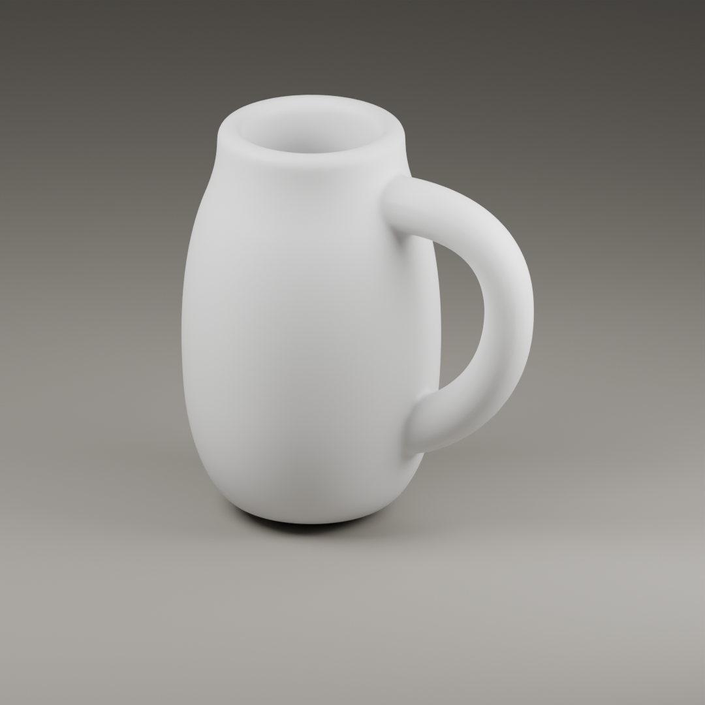
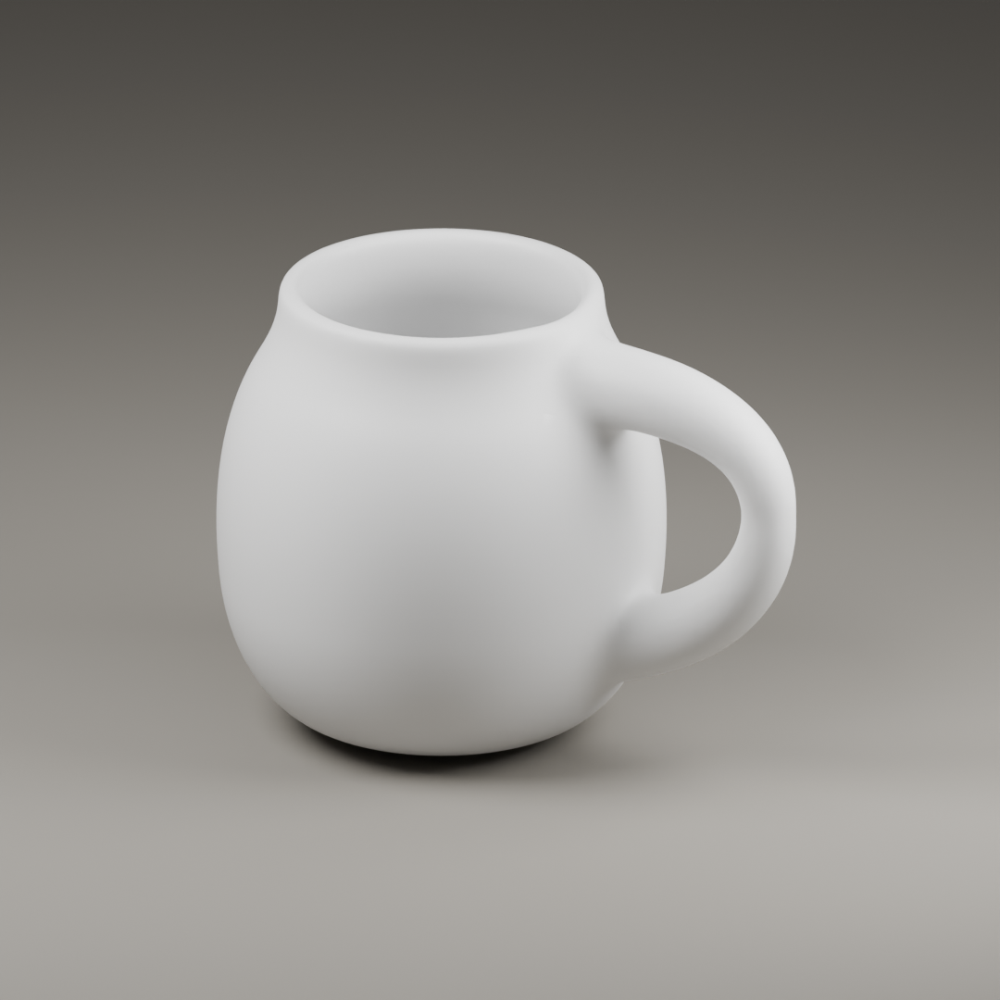
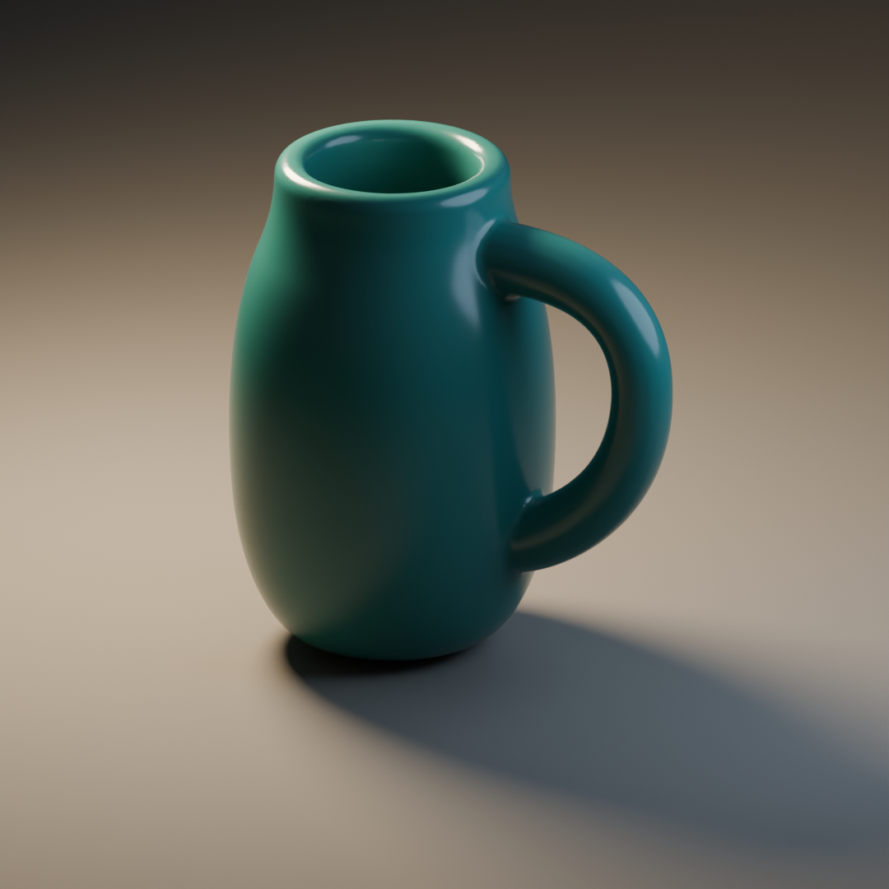
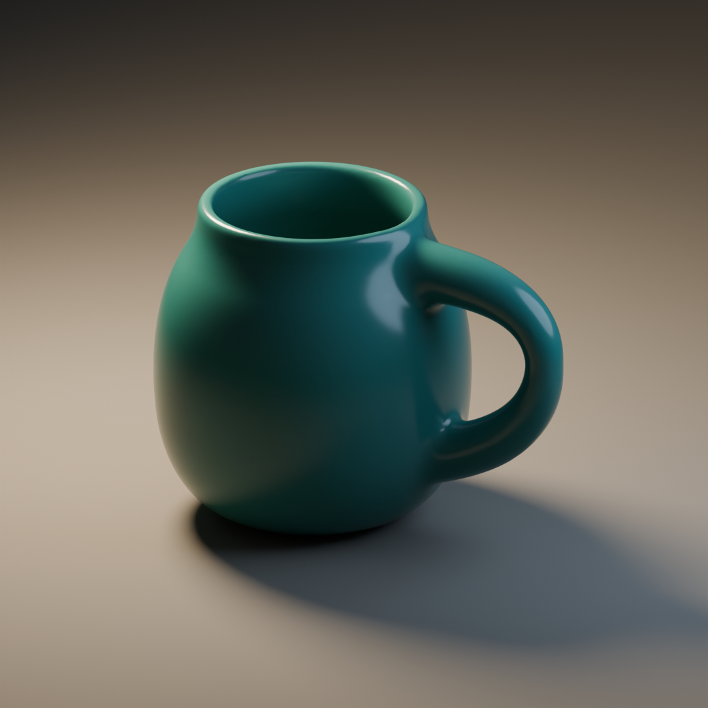

# Form construction: a body and its handle

This original authored study explores a low, settled hollow body with a light
outward reach. It makes one construction inspectable, not an authoritative
standard of vessel design. The upright version can suit a different intention;
the broader revision serves this study's chosen low mass. Neither is a
manufacturing, grip-ergonomics or fluid-pouring design.

## Open the thing that answers the question

- [Interactive comparison](../assets/vessel-study/viewer.html): the actual GLBs
  in Three.js, with independent geometry, surface and illumination controls;
  front, handle-edge, interior and inner-wall views plus orbit. Serve the
  package over localhost as described below.
- [Blender source](../assets/vessel-study/vessel-study.blend): editable
  construction meshes, Bezier handles and cavity cutters, evaluated delivery
  meshes, neutral stage and camera, and the embedded build script.
- [Build script](../scripts/build_vessel_study.py): the profile, handle
  controls, two parameter sets, root blending, export and two lighting setups.
- [Upright GLB](../assets/vessel-study/upright.glb) and
  [low-bellied GLB](../assets/vessel-study/low-bellied.glb): neutral materials,
  geometry and parameter metadata; no Blender node graph or live modifiers.





The first construction has a narrow body, thick lip and near-uniform handle.
In the revision, body width increases while height falls; the upper wall still
tightens into the opening. The lip becomes thinner, and wider handle roots
lead into a slimmer outer span. These changes redistribute both material and
empty space. Colour is held fixed in this comparison.

## How the volume is made

The script revolves a section through a full turn. The section travels from
the underside up the outer wall, over a semicircular lip, down the inner wall
and across the interior floor. The two center poles cap the floor and base;
the top remains an opening. The result has a real interior, not a dark disc
under a rim. The source section is sampled from three cubic curves, whose
controls put the fullest mass below the shoulder and tighten toward the lip.

The handle is a two-span Bezier curve with variable radius. Its endpoints
penetrate the body wall, and its tangent controls choose the reach and return.
The source handle is separate so those choices remain editable. A voxel remesh
unites handle and shell into one delivery volume. Smoothing removes the raw
join; the revised version gives the roots a broader **local** blend instead
of rounding every edge more.

The interior remains a separately controlled surface. A thick handle root can
intrude through a thin wall even when the exterior looks smoothly joined.
After blending the exterior, the script subtracts a revolved cavity volume
derived from the same inner profile. This retains the hollow wall instead of
accepting an internal root-shaped wedge. A finer remesh and light smoothing
finish the subtraction, then subdivision smooths voxel curvature before
delivery decimation. Inspect both sides of the wall: a watertight union alone
does not establish a usable hollow form. The resulting meshes are static
surfaces, not good deformation topology.

The lower inner return still compresses its highlight more tightly than the
outer handle. A single connected mesh and a broader root blend do not guarantee
uniform curvature continuity; a finish built around an uninterrupted sharp
reflection would warrant explicit surface control at that junction.

The native file has two collections. `EDITABLE CONSTRUCTION` is disabled in
the viewport and render; enable it and hide `DELIVERY` to inspect or edit the
section meshes and handle control points without overlapping derivatives.
The wireframe cavity objects show the negative volume used by the subtraction.
`DELIVERY` holds both evaluated meshes; only the low-bellied mesh is visible
initially. The script's `variants` dictionary is the reproducible parameter
owner. Object custom properties record the parameters used; changing those
properties alone does not rebuild the mesh. Direct source-mesh edits also need
a new evaluation/export rather than pretending the baked derivative updates.

| Control in the script | Upright | Low-bellied | What it changes here |
| --- | ---: | ---: | --- |
| `height` | 2.95 | 2.40 | Vertical mass, attachment heights and cavity depth |
| `width` | 0.94 | 1.15 | Revolved body radius profile, not overall handle width |
| `wall` | 0.19 | 0.12 | Source wall and rounded lip thickness |
| `handle_radius` | 0.21 | 0.165 | Sweep thickness before radius variation and blending |
| `root_scale` | 1.02 | 1.50 | Root thickness relative to the swept handle |
| `root_blend` | false | true | Broad local blend into the body wall |

These are normalized study units and source controls. Remeshing and smoothing
change the final surface, so the values are not certified final wall thickness
or a set of physical manufacturing dimensions. Making the voxel smaller does
not itself improve the design; a finer bad junction remains a bad junction.
Making every blend broad would erase a deliberately crisp object.

## What the finish changes, and what it cannot





These views keep the same orthographic camera and geometry as their neutral
counterparts. The material changes from warm white at roughness 0.42 to teal
at 0.20; a smaller warm rear key and cool fill replace the broad neutral rig.
The lower roughness makes reflected source shapes narrower. The smaller key
reveals curvature through a moving highlight and darkens the opposing planes.
Neither change widens the upright body, thins its lip or alters its handle
opening. The paired intervention illustrates surface and light together; the
viewer separates their controls when the contribution of each matters.

Use the interior view to inspect the lip, cavity and closed floor, the front
view for the inner/outer handle contours, and the handle-edge view for the
bridge's depth and root continuity. The opposite elevated inner-wall view
reveals the cavity behind the upper attachment. A three-quarter view alone can
hide an unresolved junction.

The browser's neutral setup combines an area light and environment fill with
screen-space ambient occlusion for recesses and ground contact. That occlusion
is view-dependent, not physical indirect light or evidence of surface
continuity. A depth-receiving floor follows each loaded mesh's lowest bound,
against an uninterrupted background. The warm/cool setup adds directional
shadow maps. The HDRI option uses the actual EXR but no shadow-casting light,
so it is a reflection/illumination comparison rather than a grounded beauty
setup. Cycles supplies different indirect light and soft shadows; these
renderers need to preserve the construction's reading, not identical pixels.

## Two external references with different jobs

[Khronos ToyCar](../assets/reference-assets/toy-car/ToyCar.glb) is an unmodified
public glTF asset by Guido Odendahl and Eric Chadwick. Its metal, coating,
window and fabric responses make an imported material/light study possible.
It is an exported scene, **not its author's modeling history**. Importing it
into Blender does not recover the original construction or justify describing
one. In the viewer, choose ToyCar and exported materials, then change the
environment or orbit; zoom for the small car's details.

[Poly Haven Studio Small 09](../assets/reference-assets/studio-small-09/studio_small_09_1k.exr)
by Sergej Majboroda provides a real captured studio reflection environment.
Its bright sources help reveal roughness and curvature. Its 1k resolution is
sufficient for this compact reflection study, not a sharp high-resolution
background. An environment-map highlight follows that environment, not the
neutral rig's authored light positions.

The external assets are CC0; their exact source, original notice, license
texts and retained-byte hashes are in [reference-asset lineage](../assets/reference-assets/SOURCE.md).
The vessel, script, viewer and rendered comparisons were authored for Charter;
they contain no ToyCar geometry, HDRI pixels or third-party model parts.

## Use and rebuild

The bundled native scene records Blender file version 5.2. Opening it needs
a compatible reader; the GLBs are the interchange outputs, not a replacement
for the editable construction. Rebuilding from the script creates a new native
file in the installed Blender's format.

The generator uses Blender's bundled Python API, glTF exporter, Cycles and AgX
view transform, with no external add-ons. The executable must provide those
APIs and the modifier operations in the script; a version number alone does
not establish that the complete generator works. Run from the package directory,
substituting your Blender executable and a new output directory:

```sh
blender --background --factory-startup --python-exit-code 1 \
  --python scripts/build_vessel_study.py -- \
  --output /absolute/path/to/new-study --renders
```

The command writes a native scene, two GLBs, geometry statistics and four PNGs.
It refuses a nonempty destination or an interactive Blender process; it does
not alter the bundled study, install software or fetch assets. Omit
`--renders` for scene and geometry only. A
failed run may leave partial output in its chosen directory.

For the browser resource, from the package directory:

```sh
python3 -m http.server 8766 --bind 127.0.0.1
```

Open `http://127.0.0.1:8766/assets/vessel-study/viewer.html`; stop the local
server with Ctrl-C. The page loads pinned Three.js 0.180.0 MIT modules from
jsDelivr, requiring network access; model and environment bytes stay local.
There is no telemetry or upload code. The native file and PNG comparisons
remain usable without the browser dependency. Rendering this sample is not
a performance budget or an acceptance test for another scene.
