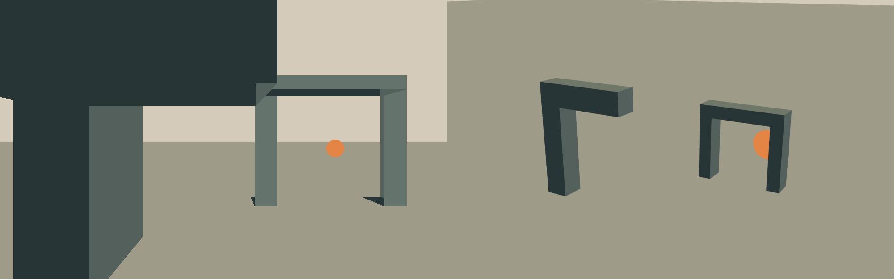
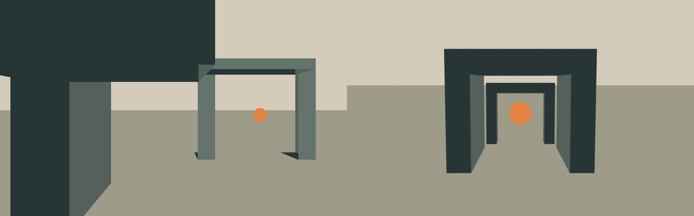
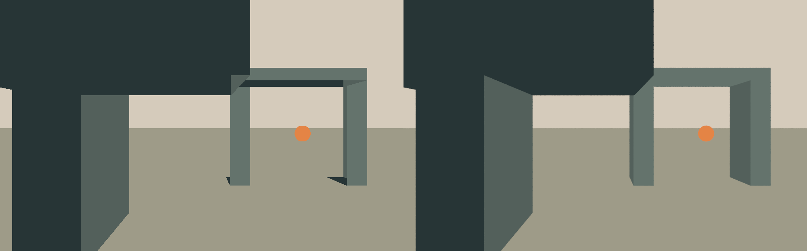
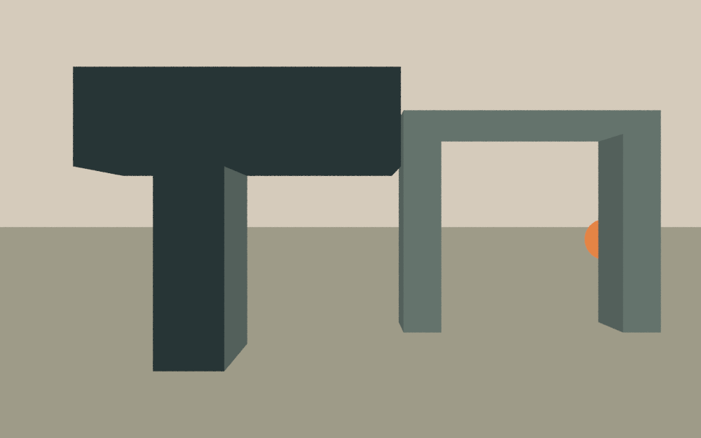
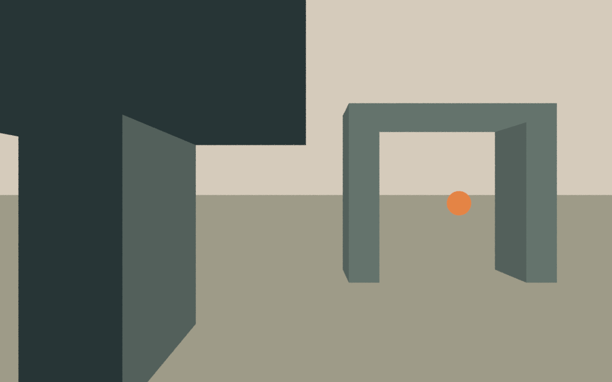
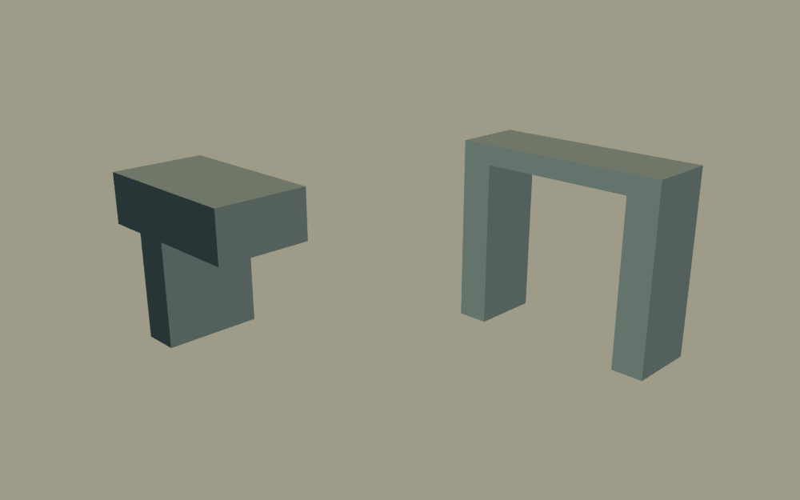
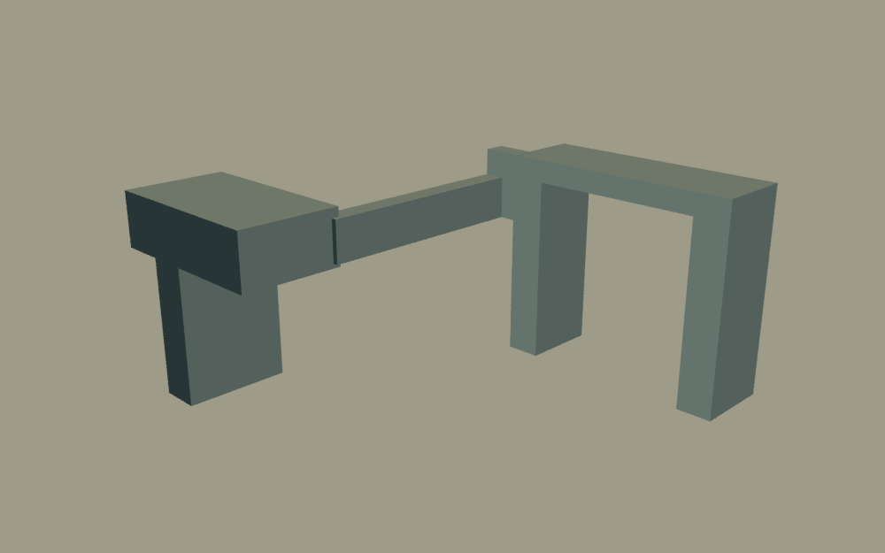
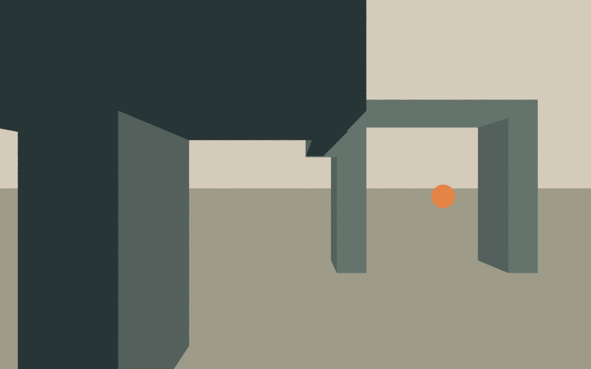
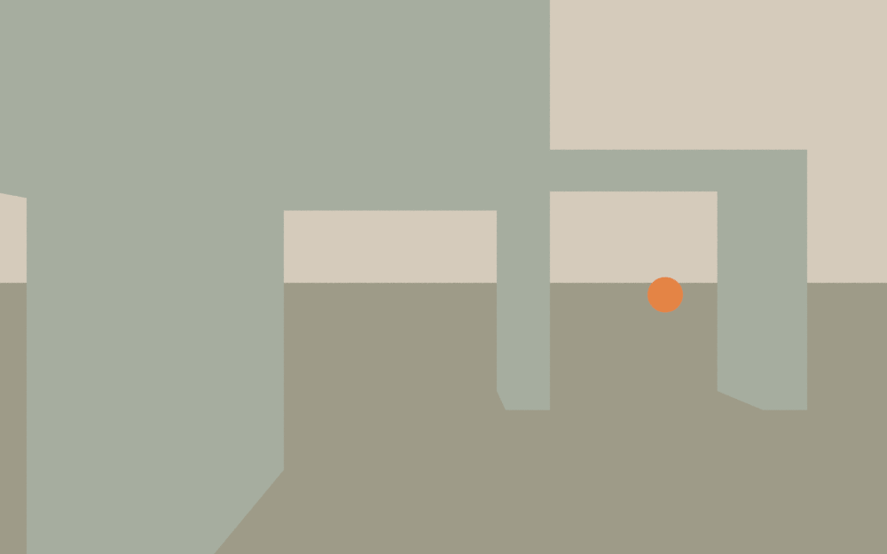

# Reference to scene: an aperture and a distant ember

Use this study when a chosen picture governs a constructed frame and the
objects are present but their scale, overlap or intervals have drifted. It
provides a working comparison and editable controls, not a reconstruction
algorithm, a quality score or a standard of finished architectural art.

## Work with the actual reference

In Blender, select the shot camera and open **Camera Data Properties →
Background Images**. Add the chosen image, set the frame method to **Fit**,
enable its display and choose **Front** with a useful opacity. Enter camera
view. Set output aspect and pixel aspect deliberately: Fit retains the image's
proportions, but letterboxing is not agreement about the commissioned crop.
Choose that crop explicitly rather than stretching the reference. Toggle the
image off to inspect the construction without its support.

This is a viewport aid. A camera background image does not enter the render.
An imported image plane, world texture or compositor image can enter it; do
not use one in its place and then mistake the picture for constructed work.
Pack the reference with the native scene when its permitted use includes
that copy, or retain a deliberate portable file relationship. The bundled
scene packs its original reference and uses `//reference.png` as its relative
path; no external image or add-on is needed.

For scripted work, render the candidate separately and compare the two
display-ready images at equal viewing size. The [small Blender script](../scripts/build_reference_scene_study.py)
also provides that operation for arbitrary supplied images. From this package
directory, substitute your Blender executable and absolute paths:

```sh
blender --background --factory-startup --python-exit-code 1 \
  --python scripts/build_reference_scene_study.py -- \
  --output /absolute/path/to/new-comparison \
  --compare /absolute/path/to/reference.png /absolute/path/to/candidate.png
```

It writes `comparison-paired.png` (reference left, candidate right),
`comparison-overlay.png` and `comparison.json`. It reads but does not rewrite
the two inputs. Each panel has the same pixel dimensions; each input is fitted
inside it without stretching, with gray letterboxing where necessary. Different
aspect ratios remain visible in the metadata and borders; settle the real
frame before interpreting correspondence. Use comparable view transforms and
display backgrounds. This helper is for ordinary display images, not scene-linear
HDR masters or colourimetric comparison. The optional overlay is a 50% blend
of their stored samples: doubled edges can locate a mismatch, not judge its
importance or reveal which 3D cause produced it.

## The chosen frame and three constructions

The original authored diagram **Aperture / distant ember** puts a large,
cropped dark mass close to the eye, a lighter opening off to the right and a
small warm disc beyond it. The offset openings and unequal masses matter;
the inventory “posts, lintels, disc” does not specify their relationship.

[Editable concept SVG](../assets/reference-scene-study/reference.svg) ·
[separate reference raster](../assets/reference-scene-study/reference.png) ·
[editable Blender scenes](../assets/reference-scene-study/reference-scene-study.blend) ·
[construction controls and projection report](../assets/reference-scene-study/controls.json)



The literal construction retains two structures and the disc. Its higher,
distant three-quarter view presents them as separate display objects. The
near structure no longer occupies the frame, and the enlarged disc competes
with the structure around it. Counting the right parts would miss this change.
[Separate render](../assets/reference-scene-study/literal-inventory.png).



The engineered interpretation makes broad joined walls and centered nested
gates. It is spatially more regular but substitutes symmetry, enclosure and a
large central disc for the selected crop and asymmetric interval. Those choices
could suit another commission; their apparent completeness does not make them
a recovery of this one. This is not a certified architectural design.
[Separate render](../assets/reference-scene-study/engineered-gate.png).



The reference-informed block-out preserves the large near crop, offset far
opening, smaller disc and separation of dark near mass from lighter far mass.
It does not pixel-copy the diagram. The inner side-face layering and the
under-lintel junction differ: a depth-bearing construction exposes surfaces
that a flat drawing can simply paint over. Decide whether such a difference
changes the commissioned reading, rather than treating either pixel agreement
or any departure as the verdict.
[Separate render](../assets/reference-scene-study/reference-informed.png) ·
[optional overlay](../assets/reference-scene-study/reference-informed-overlay.png).

## Use camera and geometry for different repairs

The native file opens on `reference-informed`. Its named scenes hold the
alternatives; switch with Blender's scene selector. The camera, meshes and
face materials are directly editable. The external script is the reproducible
parameter owner; object properties record authored inputs but do **not**
rebuild geometry when edited. The embedded text block is a copy of that source,
not an automatic updater.

| Control | What it changes in this study |
| --- | --- |
| Camera location, aim and focal length | Relative apparent size across depths, convergence, crop and overlap |
| `PARTS[*].rect` | Authored front-face bounds in the chosen frame; fractions run from the top left |
| `PARTS[*].depth` and `length` | Placement and extent along the hero view; this changes side faces and parallax |
| Near lintel mesh's right end | The interval/overlap with the far opening, without moving the far disc |
| Disc position and radius | Its location, scale and visibility through the opening |
| Face materials and world/floor values | Separation of near mass, far opening and focal accent |



Here the camera moves from `(0, -8, 2)` at 24 mm to `(0, -14, 2)` at 43.2 mm,
with a 36 mm sensor. Geometry stays fixed. The near cap becomes an uncropped
object and the disc slips behind the right pier. Moving the camera and changing
focal length together did not retain all relationships: depths project
differently. Returning to the closer camera restores their intended relative
scale and overlap. Neither focal length is intrinsically better.



Here only the near lintel's right end moves from world X `0.54` to `0`.
The far frame and disc retain their projection, but a gap replaces the
apparent connection. Extending that end repairs this interval without the
global changes a camera move would introduce. In an unknown reference, depth
and camera are not uniquely recoverable from these bounds; test the controls
that can change the actual mismatch, not these numbers as a preset.

The report calls Blender's `world_to_camera_view` on world-space bounding-box
corners. Its X/Y origin is **bottom left**, unlike the authored rectangles;
`0..1` spans the frame. Values outside it remain outside, and depth is retained
so points behind the camera are not mistaken for ordinary projected bounds.
These are projected 3D boxes, including hidden parts—not visible silhouettes,
occlusion masks, contact judgments, material descriptions or aesthetic scores.
An empty gap can matter even when all reported extents look plausible.

## Change the commission: walk around it

The diagram intentionally makes the two overhead pieces look joined while
leaving their depth relationship ambiguous. This is an **authored** ambiguity,
not an image generated by a model. The chosen construction interprets them as
separate slabs whose projections meet. An ambiguous generated concept can
require the same choice, but no unique mechanism is recovered here.



For a fixed frame, the unseen gap can be legitimate scenic construction if no
other requirement forbids it. The new commission—walk around a continuous
structure—makes that interpretation insufficient. The oblique view reveals
the gap and a near pier whose concealed base stops above the floor.



The alternative adds a connecting return and raised joint and extends the
near pier to the floor. It now has geometric continuity from this side; this
does not establish load-bearing adequacy, human clearance or a pleasing moving
view. It changes the hero frame too:



The added underside intrudes into the interval. A moving-view commission
therefore requires redesigning both spatial continuity and the views, not
preserving the hero picture at all costs. If the picture instead supplies only
a mood, borrowing its palette and rhythm may be appropriate; matching its
accidental contour would be the wrong obligation.

## Projection is not the whole appearance



This version keeps the hero camera and geometry but equalizes face materials
to a light gray-green. The dominant dark near mass and its separation from the
far opening disappear. Matching projected extents cannot recover that value
structure.

The study deliberately uses emission shaders and authored face colours to
make spatial and value choices inspectable. It does not teach a physically
lit architectural finish. Real roughness, reflection, translucency, atmosphere
and illumination can change the intended effect even when the layout holds.
Keep those causes visible in the target renderer when they are decisive;
these flat blocks cannot settle them. The existing material/light references
and the vessel study address different construction questions.

## Source, rebuild and limits

The SVG, raster, meshes, script and comparisons are original Charter-authored
teaching material. No third-party pixels, models, fonts, downloaded assets or
generated imagery are incorporated. The known rectangles are deliberately
shared by the concept authoring and scene conversion so the correspondence is
inspectable. This is not evidence of recovering unknown geometry or a camera
from a picture, and is not a successful transfer trial on independent work.

The bundled native file was authored with Blender 5.2. It uses Blender Python,
Cycles, ordinary mesh data and emission nodes; no external add-on is required.
From the package directory, rebuild into a new destination:

```sh
blender --background --factory-startup --python-exit-code 1 \
  --python scripts/build_reference_scene_study.py -- \
  --output /absolute/path/to/new-study --renders
```

Omit `--renders` for the editable native scene, reference and controls only.
The generator refuses a nonempty destination and refuses an interactive
Blender process; run it separately rather than clearing an open user scene.
It downloads nothing and does not modify the bundled resource. A failed run
can leave partial output in the chosen directory. The optional comparisons
are inspection derivatives, not part of any candidate render.

The generated panel metadata records dimensions and placement:
[inventory](../assets/reference-scene-study/literal-inventory.json),
[engineered](../assets/reference-scene-study/engineered-gate.json),
[reference-informed](../assets/reference-scene-study/reference-informed.json).
The inventory and engineered [overlays](../assets/reference-scene-study/literal-inventory-overlay.png)
[remain available](../assets/reference-scene-study/engineered-gate-overlay.png),
but the separate unblended images carry the verdict. Rebuilding a valid file,
passing the script's known-axis projection check or obtaining agent approval
does not establish artistic success in another commission.
