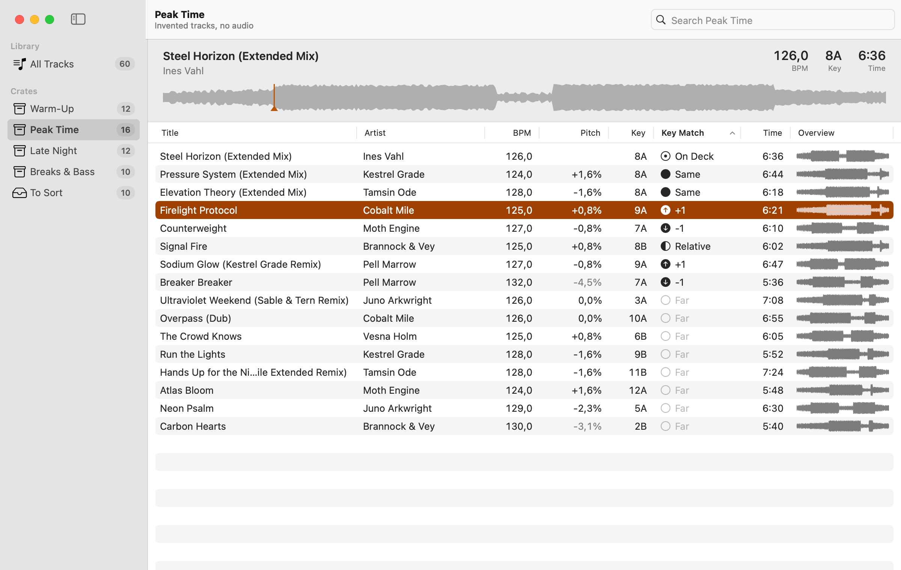
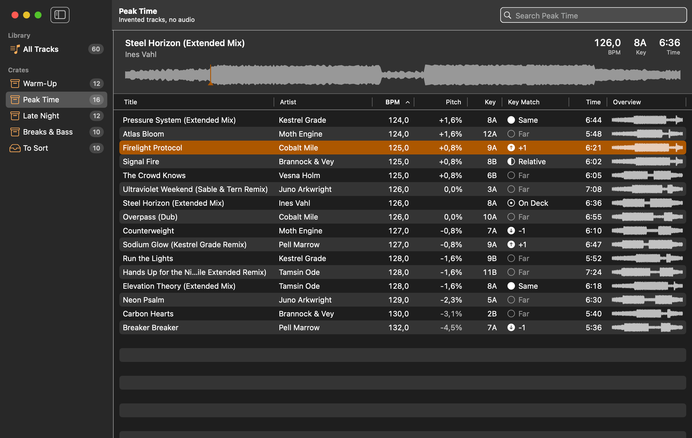
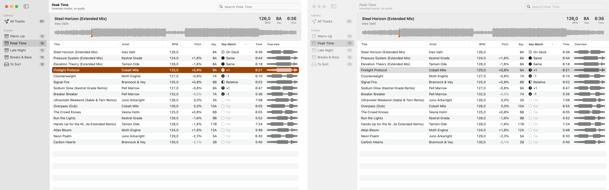
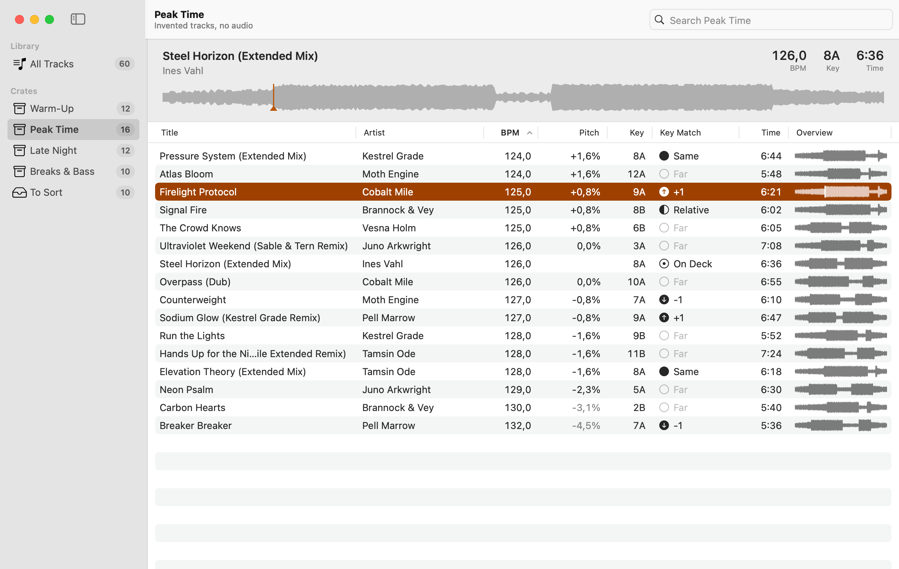
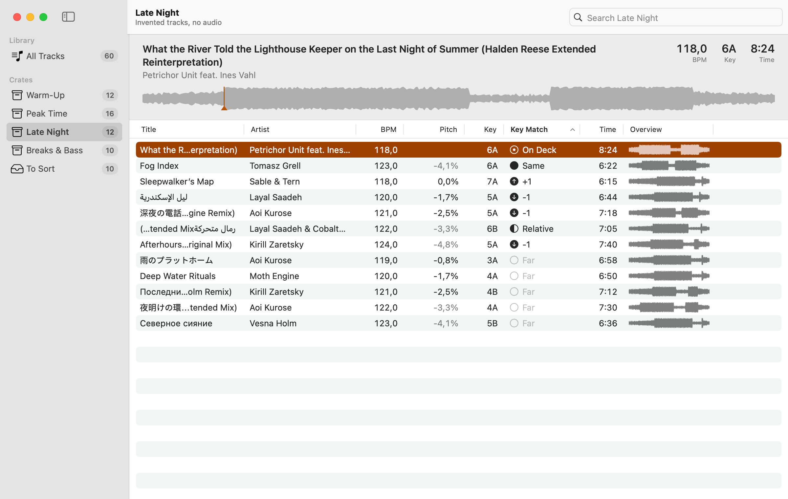

# A native crate library

A DJ preparing a set at home: at a desk, at the keyboard, for hours, choosing
the next record by tempo and key against the one on the deck. The
[runnable SwiftUI source](../assets/crate-library/README.md) is a small,
offline macOS app written for Charter. Use it to see a Mac app whose identity
is its density and its reading of the work rather than an object on a ground,
and how a table, a keyboard path, menu commands and Undo form one interaction.

Every artist, title and remix credit in it is invented, and so are the tempos,
keys and lengths; any resemblance to a real record is accidental. There is no
audio.

## Spend identity on the reading against the deck

A table of title, artist, tempo and key would serve any music library, a
podcast archive or a sample browser equally well. What makes this one a DJ's
tool is that every row is read against the track that is playing. Each
particular of the work became one decision:

| From the work | Decision |
| --- | --- |
| The playing track is the reference for every choice | A band across the top of the table holds the deck: full title, artist, waveform with the cue point at the drop, and tempo, key and length as readouts with a legend under each |
| A pitch fader moves tempo a few percent; half- and double-time also mix | A Pitch column: the signed change to one decimal, with "2×" or "½×" where that is closer, dimming past 3 and then 8 percent |
| The Camelot wheel: same key, one step either way, or the relative major or minor | A Key Match column of shape and word, and a sort that puts mixable tracks first and, among tracks that match alike, the smallest pitch change first |
| Versions differ at the end of the title: "Extended Mix", the remixer | Titles lose their middle when they do not fit, never their end |
| Records are filed in crates | A sidebar of crates with their counts; search covers the current crate |
| The Cue button on a deck is amber | The accent: the selection and the cue point, nothing else |
| Preparation happens by daylight and for hours | Light is the main appearance; body text at Mac density; tabular figures everywhere a number is compared |

Identity stops there. There is no artwork, no custom row, no dark "booth"
theme and no display face. The sidebar, the toolbar search, the
`Table` with its headers, resizing and alternating rows, the menu bar and the
window are the system's, at the system's sizes. The only text above body size
is the deck's: the title in Title 3 and the readouts in Title 2 with caption
legends, as a deck labels its display.

The [order counter](order-counter.md) spends its identity on one object, a
ticket on a ground, read at arm's length. This library has no object to frame:
the table runs edge to edge and is the work, and the deck band is the figure
the rows are read against. Both are native; they differ because the work
differs.

## Compatibility without color

On Deck is a dot in a ring, Same a filled circle, +1 and -1 filled arrows
round the wheel, Relative a half-filled circle; each sits beside its word in
the primary style. Far is a hollow ring and No Key a dashed one, both
tertiary. A track with no key shows a dash in the Key column. The accent never
carries compatibility, so a selected row, an inactive window, Increase
Contrast and a person who cannot tell amber from green all read the same
column.

VoiceOver reads each cell as a label and a value rather than a symbol name:
"Key match, one step up the wheel"; "Pitch, speed up 1.6%", with "at double
time" or "at half time" where that applies; "Waveform" with its intro, breakdown and
outro times, and "Previewing at" the playhead's position while a preview runs.

## The keyboard path

Focus starts in the table, and the whole job can be done from there:

- the arrow keys move through the tracks;
- Return loads the selected track to the deck, as do a double-click and
  **Track → Load to Deck** (Command-L);
- Space starts and stops a preview of the selected track, as does
  **Controls → Play Preview** or **Stop Preview**; while a preview runs,
  moving the selection previews each track from its drop;
- **Track → Move to Crate** (Option-Command-1 to 5) files the selection, and
  **Edit → Undo** puts it back;
- **View → Sort By** (Control-Option-Command-1 to 7) sorts as clicking a
  column header does, with Pitch and Key Match disabled until a track is on the
  deck;
- **Track → Eject Track** (Command-E) empties the deck.

Return and Space are handled by the focused table, not by the menus. A plain
Space key equivalent in the menu bar risks catching a space typed in the
search field; handled by the table, it applies only while the table has focus.
The Controls menu still names the command, without a shortcut beside it, so
the menu bar documents every command but not this key. That trade was reasoned
from how menu key equivalents are matched, not tested with a shortcut in
place.

## One verb from menu to Undo

Moving a track is the one edit the library makes, and it reads the same from
the menu to the Undo title. `Library.move` registers its own inverse with the
window's undo manager under the action name, and registers nothing when every
selected track is already in the target crate. Observed in the running app,
through its own menu items:

- Track → Move to Crate → Late Night moved track 27 out of Peak Time.
- The Edit menu read **Undo Move to Late Night**; Undo put it back.
- The Edit menu then read **Redo Move to Late Night**; Redo moved it again.

Commands reach the focused window's selection through a focused scene value.
Each window keeps its own crate, selection, sort and search; the library, the
deck and the preview are shared, since there is one deck and one pair of
headphones.

## A preview without audio

The preview is a playhead that starts at the drop and moves in real time over
the generated waveform, in the Overview cell of the previewing row. In the
tempo render it has run for about two seconds from the drop of track 14. The
deck's waveform carries the cue point in the accent.

## Long and non-Latin titles

With the Title column narrowed, Latin, Japanese and Cyrillic titles keep their
start and their mix name, losing the middle; the full title is in a tooltip,
in VoiceOver's reading and, for the loaded track, wrapped on two lines in the
deck. Artist names lose their end, with the full name in a tooltip. An Arabic
title that fits is set right to left in its cell.

Two things read less well than they should. A mixed-direction title such as
"رمال متحركة (Extended Mix)" is truncated in logical order, so it shows as
"(…tended Mixرمال متحركة": correct bidirectional layout, but not the
title's end as a reader would expect it. And the width the narrowed column
gives up stays empty after the last column rather than going to Title's
neighbours.

## Accent values that carry white text

The accent is a selection fill behind white text in every appearance. Light
is #B85500, dark #D67A14, light High Contrast #8F4000 and dark High Contrast
#AC5700. In dark appearance with Increase Contrast, macOS drew the table's
selection in the High Contrast value exactly as given, so a brighter dark High
Contrast amber, the direction the system's own colors take, left white text at
1.8:1 in an earlier build. Measured on the selected rows in the renders, white
text has 6.5:1 in light, 5.0:1 in dark, 7.2:1 in light High Contrast and
5.1:1 in dark High Contrast. In dark appearance with the Mac's own Orange
accent replacing the app's, it has 4.1:1.

## What was observed and what was not

Observed in launches through `open`, each step in its own short launch with
the app active and its window key and with the per-process appearance and
accent arguments the [README](../assets/crate-library/README.md#renders)
lists: Load to Deck, Sort By BPM and
Key Match with the resulting order checked, Play and Stop Preview with the
playhead's movement checked, Move to Crate with Undo and Redo, a second window
from the File menu, and every appearance in the renders. Choosing a crate,
selecting a row and narrowing the column were done by setting the state that
the click, arrow key or drag would produce; the log names each such stand-in.
The off-screen `--exercise` checks key matching, pitch, the sample content,
moves with their Undo titles, the Key Match order and search scoped to the
crate, including a Cyrillic query.

Not exercised, because each needs real input or a relaunch the exercise does
not make: Return, Space, double-click and the arrow keys; every keyboard
shortcut; clicking a column header or dragging its edge; typing in the search
field; the context menu; restoration after quitting; tooltips; VoiceOver, Full
Keyboard Access and Reduce Transparency. The renders draw sidebar and bar
materials as flat fallbacks.

## What the example does not show

- **Audio.** No playback, beat grid, sync or waveform analysis; the waveform
  is generated from a seed.
- **Drag and drop.** Tracks move only by command: not by dragging to a crate,
  between windows or within a crate.
- **Library management.** No import, file access or key and tempo detection;
  no creating, renaming or deleting crates; no playlists or set order.
- **Persistence.** Moves last until the app quits. Column widths and order are
  not saved.
- **Larger text.** The Mac has no Dynamic Type, and this app offers no text
  scale; the order counter shows one.
- **Scale.** Sixty tracks in memory; a real library needs paged or lazy loading
  and search over far more.
- **Other platforms.** It is a Mac app only.

## What to borrow, and when to choose differently

Borrow the reference band that every row is read against, derived columns
that sort like any other, meaning carried by shape and word, the keyboard path
with Space scoped to the table, scene-scoped commands, and an undoable edit
whose name runs from menu to Undo. Two decks would need a way to choose which
one the table reads against. A library people tune for hours would keep its
column widths and visibility with `TableColumnCustomization`. Where
mixed-direction titles are common, test truncation with them before choosing
middle truncation.
