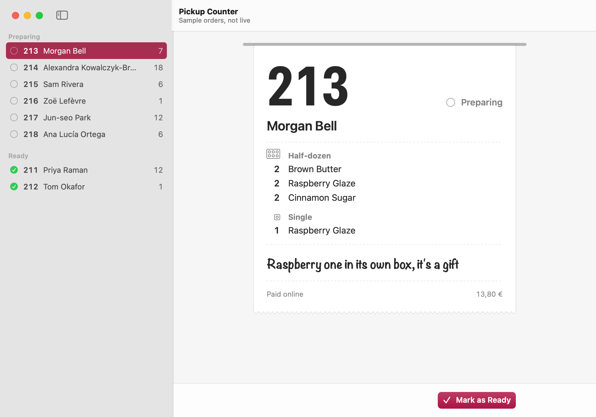
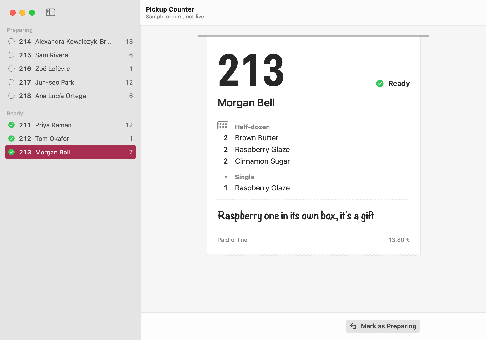
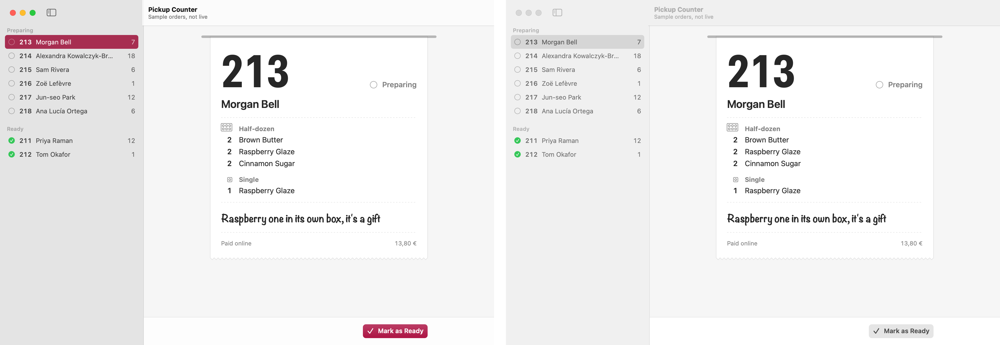
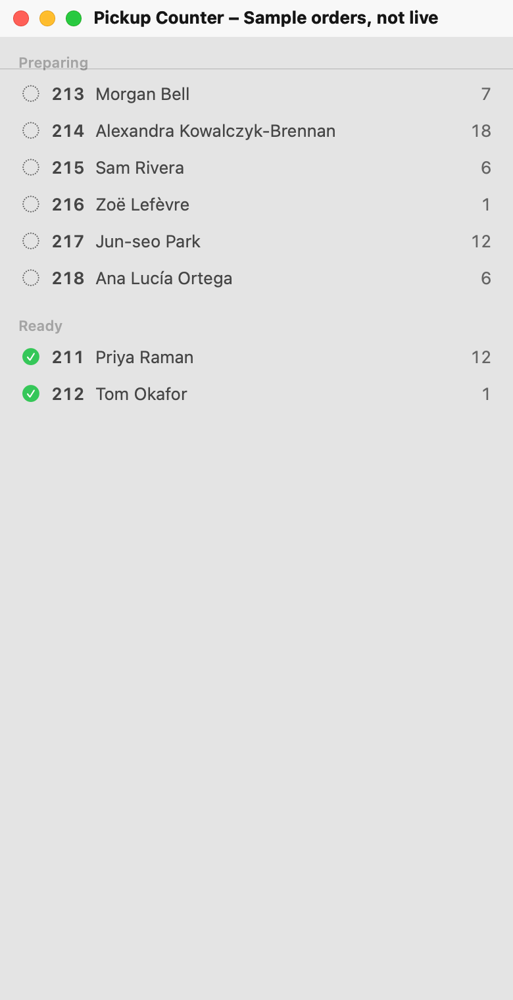
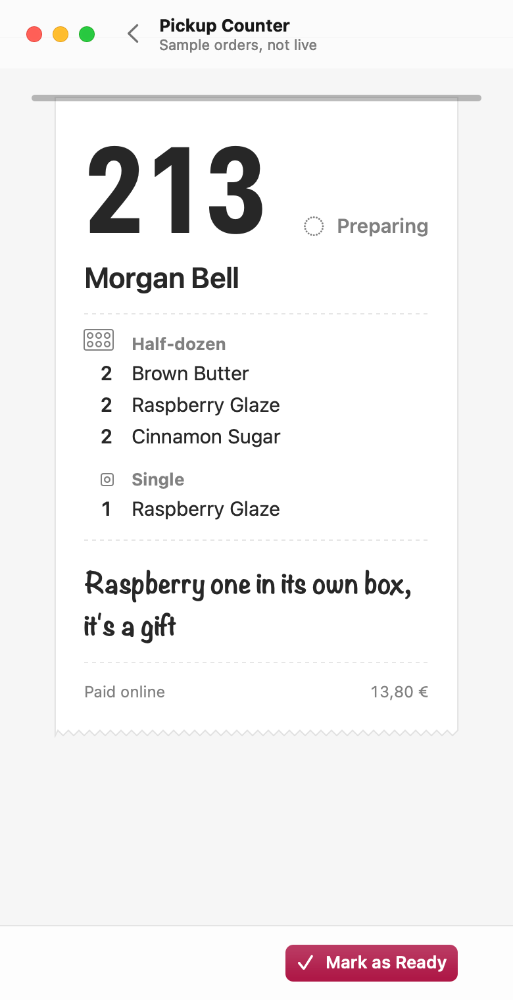
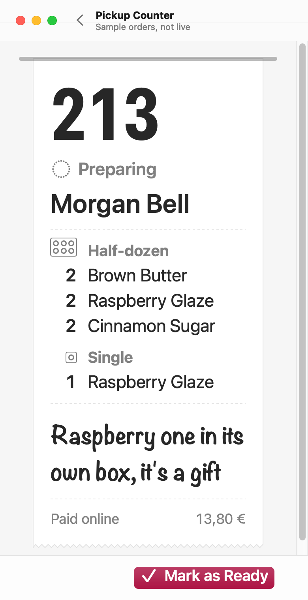

# A native order counter

A doughnut shop's pickup counter in the morning rush: staff box a paid order,
call its number aloud and check the name when someone steps forward, reading
the screen at arm's length with both hands busy. The
[runnable SwiftUI source](../assets/order-counter/README.md) is a small macOS
adaptation of Apple's MIT-licensed Food Truck sample. Use it to see where an
app's identity comes from its subject and where it is left to the system, and
how shared state, selection, commands and Undo form one interaction.

## Spend identity on the ticket

The counter's own objects are the paper ticket on its rail, the called number,
the box sizes people order and the note someone scribbled. Each became one
decision:

| From the counter | Decision |
| --- | --- |
| The number is called aloud and read from arm's length | The one fixed size in the app: 92-point bold condensed, tabular figures |
| The name is the cross-check | Title style directly under the number |
| Tickets hang from a rail | A square-topped sheet with a torn edge under a plain rail bar; dashed perforations between its parts |
| A single, a half-dozen, a dozen | Each box headed by its size and a glyph of its slots; quantities in one column across all boxes |
| A note scribbled on the ticket | Noteworthy, which ships with macOS, sized to sit level with the Title 3 lines; no card |
| Orders are paid online | The total at the foot, callout size, secondary |
| The pink box | The accent: the primary action and selection |

Asked of the first draft, a competent grey list and detail with a large
number, the question was whether it would have come out the same for a
pharmacy's prescription pickup or a parcel desk. It would have. The ticket,
the box sizes and the note are what make it this counter, and they all live in
the content.

Identity stops at the content's edge. The queue is a sidebar list at Mac
density with system text styles; commands are in the menu bar; the window,
toolbar, split view and stack are the system's. The second question, whether
anything would feel foreign to someone who lives on the Mac, is answered there.

## Keep state and action apart in color

Ready is a filled check in the system's green beside the word Ready; Preparing
is an open dotted ring beside the word Preparing. The accent is pink and marks
only the action and the selection, so the action's color never reads as the
state. Marking ready is the primary action; taking it back is a correction, so
it steps down to a plain button with the same verb: Mark as Preparing.

In the inactive window, on the right, the action loses its tint and the
selection turns grey. The button still reads as the action through its label,
its position at the end of the ticket and its check symbol.

## One verb from button to Undo

The button, **Order → Mark as Ready** (Command-R) and the Edit menu all use one
name. `OrderStore.setReady` registers its own inverse with the window's undo
manager and passes the action name through, so Redo keeps it. Observed in the
running app, through its own menu items:

- Order → Mark as Ready marked 213 Ready, left 214 alone and kept 213
  selected; the same menu item then read Mark as Preparing.
- The Edit menu read **Undo Mark as Ready**; Undo returned 213 to Preparing.
- The Edit menu then read **Redo Mark as Ready**; Redo marked it Ready again.

The command reaches the focused window's selected order through a focused
scene value, so two windows never compete over a global "current order".

## Preserve the object when composition changes

`OrderStore` owns the orders; `CounterNavigation` owns one window's selection
and compact path. Queue and ticket both read the order from the store by its
number. A second window, opened with File → New Pickup Counter Window, shares
the orders but keeps its own selection, and each window restores its own
selected order and text scale when macOS restores it.

Under 720 points the split view becomes a stack. Narrowing with 213 selected
puts its ticket on the stack; widening keeps 213 selected and clears the
stack. The breakpoint suits this queue, not a device.

## Let larger text rearrange

The Mac has no Dynamic Type, so **View → Larger Text** is this app's own 150
percent content scale. Text styles are scaled by their Mac point size; the
number keeps its size because it is already sized for distance. Where the
number and the state no longer fit side by side, the state drops under the
number instead of either wrapping, and the action bar stays in view under a
ticket that now scrolls.

See also the [wide window with Larger Text](../assets/order-counter/renders/wide-larger-text.png),
[dark appearance](../assets/order-counter/renders/dark-wide.png),
[Increase Contrast](../assets/order-counter/renders/increase-contrast-wide.png)
and the window [as the Mac was set up](../assets/order-counter/renders/as-configured-wide.png),
where the person's Orange accent replaces the shop's pink.

## Choose High Contrast values for what sits on the accent

The accent is a fill behind white text: the selected row and the prominent
button. In the counter's renders macOS drew those fills a little darker than
the accent itself. In the crate library's table, in dark appearance with
Increase Contrast, it drew the selection in the High Contrast value exactly as
given, and a bright amber there left white text at 1.8:1. A dark High Contrast
value made brighter, as the system's own colors are, risks that pale fill. The
counter's dark High Contrast pink is therefore a deep one. Measured on the
fills in its renders, white text has at least 5.9:1 in every appearance.

## What was observed and what was not

Observed in launches through `open`, with the app active and its window key
and with the per-process appearance and accent arguments the
[README](../assets/order-counter/README.md#renders) lists: the menu commands,
Undo and Redo above, New Window, Larger Text in both layouts, the resize to
compact and back, and each appearance in the renders. The off-screen
`--exercise` checks the same state through the store and the undo manager.

Not exercised, because each needs real input or a relaunch the exercise does
not make: the Command-R shortcut, arrow keys in the queue, clicking a row,
pressing the stack's Back button (the exercise clears the stack path, the state
Back produces), restoration after quitting, VoiceOver and Reduce Transparency.
The renders draw sidebar and bar materials as flat fallbacks.

## What to borrow, and when to choose differently

Borrow the single state owner, routing by identifier, the scene-scoped command
with Undo, and the switch between simultaneous and serial work. The shop, two
states and eight orders are this example's choices. A counter that calls names
rather than numbers would give the name the large figure. For comparing many
orders across sortable attributes, use a table, as the
[crate library](crate-library.md) does, or Apple's upstream
[OrdersTable](https://github.com/apple/sample-food-truck/blob/3954a769e99f3cc53297d94f2b960ceb2665b3d6/App/Orders/OrdersTable.swift).
For collection or payment, replace the local toggle with the real transition
and its failure behaviour; marking a fixture ready completes nothing.

Upstream anchors: [OrdersView](https://github.com/apple/sample-food-truck/blob/3954a769e99f3cc53297d94f2b960ceb2665b3d6/App/Orders/OrdersView.swift),
[OrderDetailView](https://github.com/apple/sample-food-truck/blob/3954a769e99f3cc53297d94f2b960ceb2665b3d6/App/Orders/OrderDetailView.swift)
and [FoodTruckModel](https://github.com/apple/sample-food-truck/blob/3954a769e99f3cc53297d94f2b960ceb2665b3d6/FoodTruckKit/Sources/Model/FoodTruckModel.swift).
The adaptation and full MIT notice are kept with the local source.
