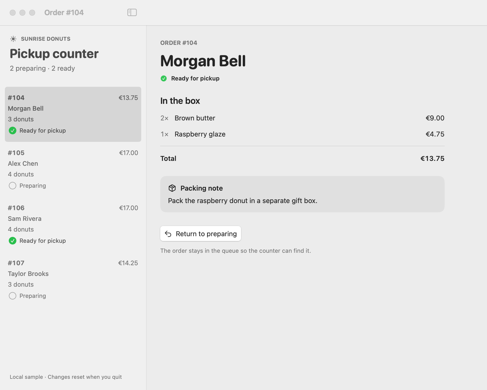
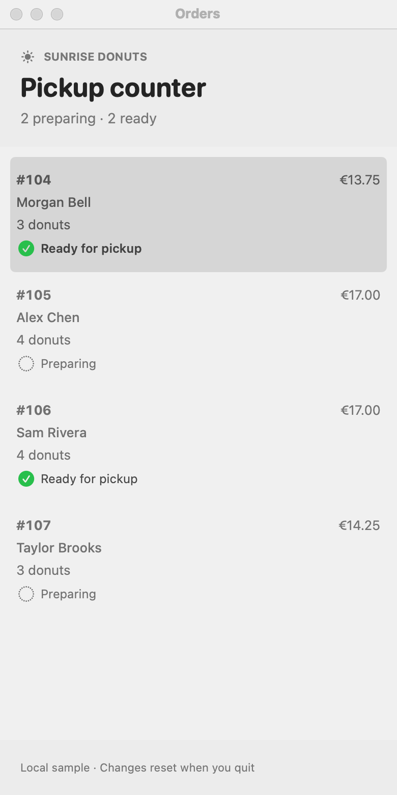
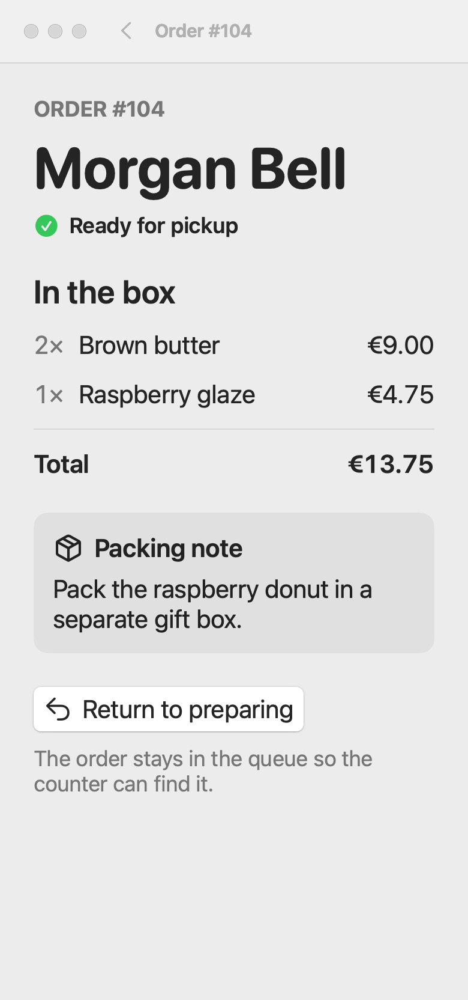

# A native order counter

An operator chooses an order, checks the items and packing note, marks it ready
and returns to a queue that visibly carries the change. The
[runnable SwiftUI source](../assets/order-counter/README.md) is a small macOS
adaptation of Apple's MIT-licensed Food Truck sample. Use it to inspect how
content, selection, commands and shared state form one working interaction.

## Let the action leave evidence in the content

The queue exposes identity, customer, quantity, total and readiness. The detail
puts identity and current state before contents, packing instruction and the
action. After activation, both presentations read the changed order; a toast
would not substitute for that visible state.

Compare the same view [before the status change](../assets/order-counter/renders/wide-preparing.png).
The order stays in the queue, and the action becomes **Return to preparing**.
The reversible action is appropriate to a counter correction, not to every
fulfillment transition. Text and the checkmark carry readiness together, so
green alone is not its meaning. The packing note gets a quiet content group;
it is neither navigation nor a floating glass control.

## Preserve the object when composition changes

`OrderStore` owns the orders; `CounterNavigation` owns one window's selected ID
and compact path. Both list and detail obtain an order from the same store.
The detail receives the current value and an action that mutates the store,
rather than editing an independent copy. Opening another window shares orders
but not its selection.

Wide geometry makes the comparison simultaneous. Under 720 points, the same
content becomes serial: list, detail, Back to list. Narrowing a selected wide
view places that ID in the stack path; widening keeps the selection while
clearing the compact path. The breakpoint is a choice for this small queue,
not a device or orientation test.

Inspect native Back and reopening of the changed order in the running app.
The bundled off-screen probe prepares this list through state instead; its
README distinguishes that probe from the native interaction.

The menu command uses a focused scene value, so its title and operation follow
that window's selected order. There is no global “current order” for windows
to compete over. The detail button and Command-Shift-R reach the same mutation.

## Let text use space

At 390 points, enlarged text preserves the customer, item names, prices,
wrapping packing note and action. The scroll view can accommodate further
height. Fixed-size prices retain their columns while item names can wrap;
the note has no fixed height. This Mac example uses an explicit content scale,
not iOS Dynamic Type, and does not establish VoiceOver behavior.

The example uses standard list, stack, split view and button components, a
system content background, typography and spacing. Native character does not
require custom translucent surfaces or illustrative filler. System chrome may
change with the SDK, OS and appearance without changing the content contract.

## What to borrow, and when to choose differently

Borrow the single state owner, ID-based routing, scene command scope and
adaptation of simultaneous versus serial work. The source is intentionally
small enough to follow those relationships together. Its bakery identity,
two readiness states and four-row queue are particular choices.

For many orders compared across sortable attributes, Apple's upstream
[OrdersTable](https://github.com/apple/sample-food-truck/blob/3954a769e99f3cc53297d94f2b960ceb2665b3d6/App/Orders/OrdersTable.swift)
is the neighboring example: a table can support comparison more efficiently
than expanding every object into a tall row. For collection or payment,
replace the local toggle with the real state transition and its failure
behavior; do not imply that marking a fixture ready completes fulfillment.

Upstream anchors: [OrdersView](https://github.com/apple/sample-food-truck/blob/3954a769e99f3cc53297d94f2b960ceb2665b3d6/App/Orders/OrdersView.swift),
[OrderDetailView](https://github.com/apple/sample-food-truck/blob/3954a769e99f3cc53297d94f2b960ceb2665b3d6/App/Orders/OrderDetailView.swift)
and [FoodTruckModel](https://github.com/apple/sample-food-truck/blob/3954a769e99f3cc53297d94f2b960ceb2665b3d6/FoodTruckKit/Sources/Model/FoodTruckModel.swift).
The adaptation and full MIT notice are retained with the local source.
