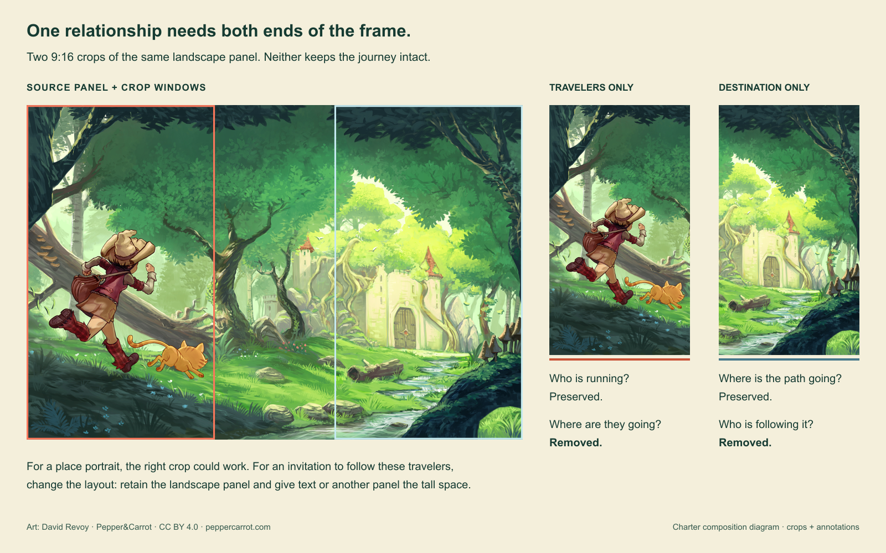
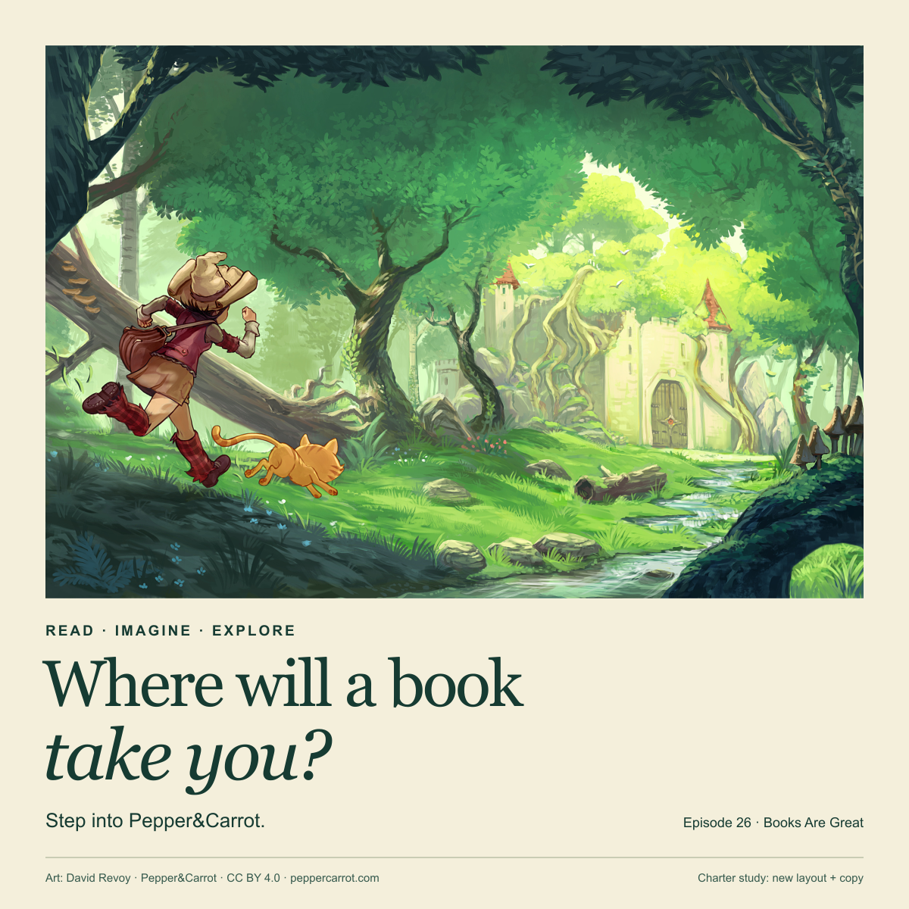
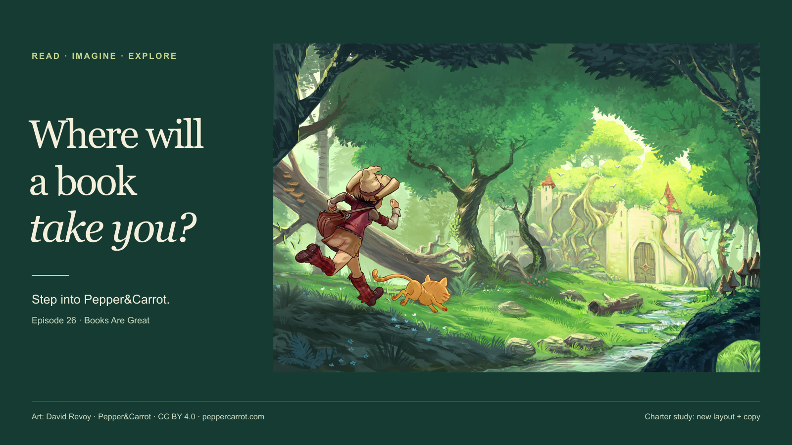
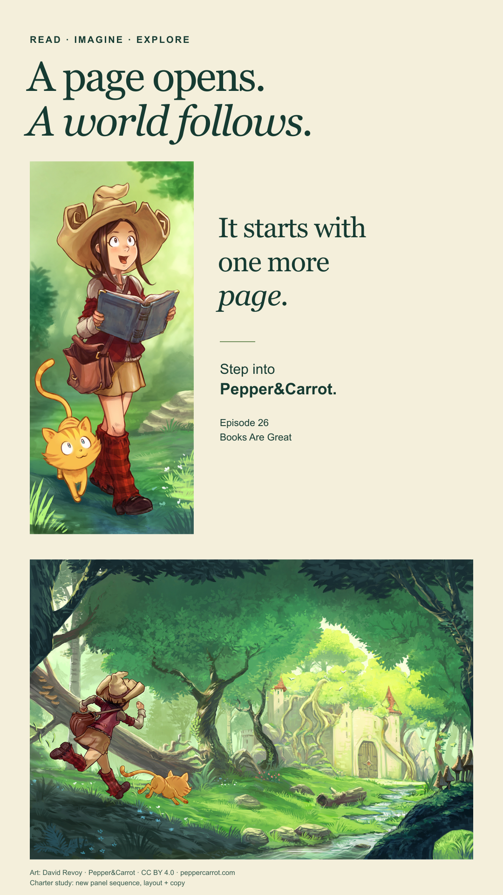

# Preserve the visual relationship when the frame changes

Use this study when an existing image must carry copy or work in several
aspect ratios. Its editable source shows panel selection, hierarchy and
layout adaptation. It does not teach how to paint the original illustration,
edit a subject on separate painting layers, or make motion.

The source is David Revoy's *Pepper&Carrot*, episode 26, page 1, under
CC BY 4.0. Charter's layouts and copy are new derivatives. The
[source, credits and editing guide](../assets/composition-study/README.md)
distinguish them and point to the external Krita source archive.

## Read what makes the source work

Open the [original artwork](../assets/composition-study/pepper-carrot-e26-p01-original.jpg).
The opening panel is a journey, not merely a character against scenery.
Pepper's forward lean, trailing bag and raised foot point across the image.
Carrot repeats the movement lower in the frame. The stream bends toward the
bright building, while the dark trees enclose the scene. The destination's
light is balanced by the warm red and orange travelers. Keeping only one end
loses the relationship that makes the other meaningful for this invitation.

The smaller panels change distance and attention: an open book and its
reader, a map, a door, then a closer encounter. A finished page therefore
offers more than one possible compositional unit. Reusing a panel is
different from cutting a character out of its environment; the former keeps
the artist's local light, edges and spatial relationships intact.

These are readings of the visible artwork, not claims about the author's
working process. For this study, the chosen purpose is to invite reading as
discovery. A location catalogue could legitimately prioritize the building
instead, and would justify a different crop.

## A crop can keep the subject and lose the proposition

The two illustrated 9:16 windows cannot hold both the travelers and the
destination. Moving the crop only chooses which to lose. That is a layout
constraint, not a damaged-image problem: an upscaler, contrast adjustment or
new text shadow cannot restore the missing relationship. The
[editable diagram](../assets/composition-study/crop-comparison.svg) retains
the exact crop windows so the loss can be inspected rather than asserted.

## Square: the image leads, type completes the invitation

The [square source](../assets/composition-study/square.svg) gives the
opening panel most of the area. The headline follows in a quiet paper field,
so foliage does not compete with letter shapes and the bright building stays
the image's focal destination. A dark green drawn from the scene ties type
to artwork; a large serif question and smaller sans-serif locator give
distinct reading distances. The paper margin is a compositional device,
not a claim that every illustration needs a frame.

## Wide: rebuild the hierarchy instead of cropping a taller poster

The [wide source](../assets/composition-study/wide.svg) moves the headline
to a left column and keeps the full journey panel to the right. The question
leads into the direction of travel; the dark ground gives the light artwork
its own field. Line breaks become a three-line invitation, rather than a
shrunk copy of the square's two lines. The travelers, stream and building
retain their relative scale. This preserves the art while changing the
composition around it.

For an edge-to-edge cinematic still with no copy, the added column would be
unnecessary. The layout follows the placement's job, not a favored template.

## Vertical: change the panel sequence, retain the world

The [vertical source](../assets/composition-study/vertical.svg) gives the
tall reader panel the first beat and the full journey panel the second.
The open book makes the reading invitation literal; the landscape carries
the promised discovery. The new copy changes with that sequence. It does
not reproduce the comic's original dialogue or claim to preserve its full
narrative. The portrait panel stays narrow because widening it by cropping
would sacrifice the hat, book or cat. Adjacent copy uses the remaining width
instead of covering those details.

This is a panel recomposition, not a portrait crop of the same master and
not a reconstruction of the original painting layers. For a commission that
must keep a single continuous scene, another source or a creative redraw
would be needed instead.

## What can be carried to another job

The reusable part is the separation between source pixels, visible panel,
copy and final frame. The SVGs make each independently editable. Localizing
the headline changes text and its allocation; changing the frame can move
panels; neither requires resampling the original JPEG. If the subject's
gesture, lighting or identity itself is wrong, those controls are
insufficient and the work returns to image creation or a suitable layered
source.

The PNG previews let the composition be judged without a design application;
the SVGs expose how it was made. Neither establishes that another image,
style, model or placement will work. Use the contrast when it resolves a
real crop-versus-recomposition decision, not as an obligatory format family.
