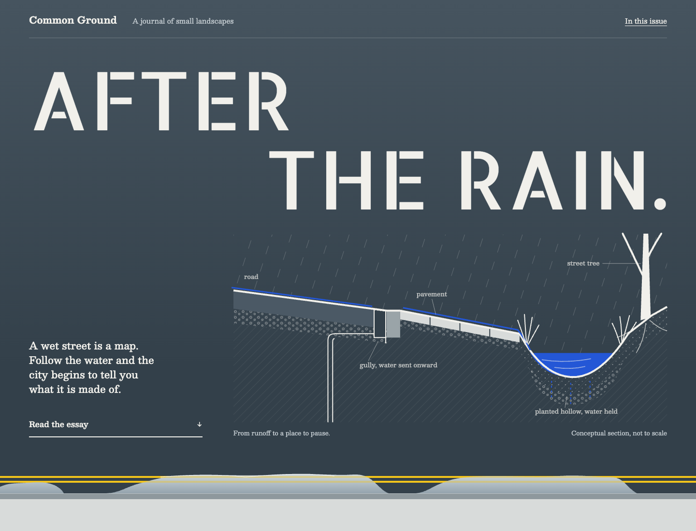
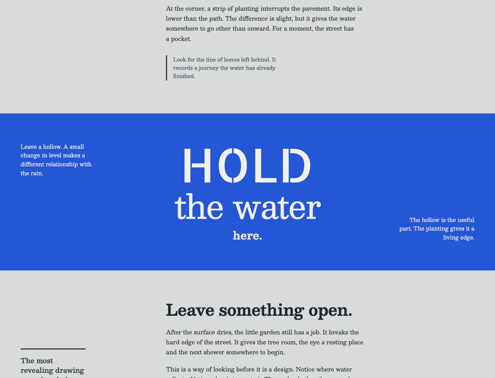
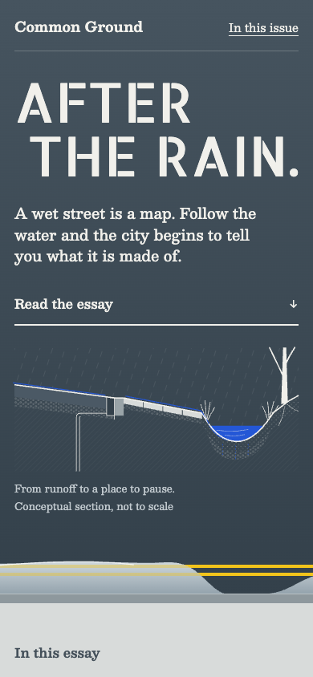
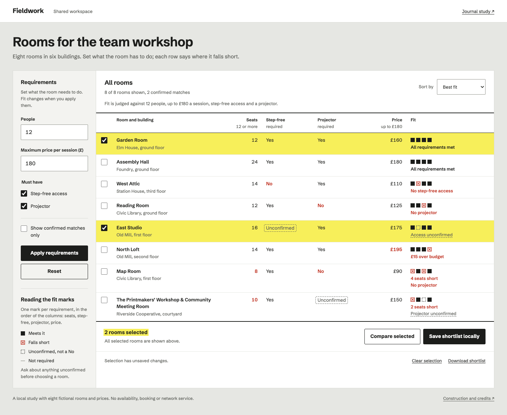
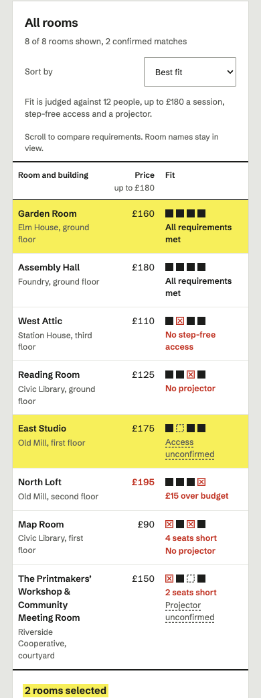

# Compositions you can take apart

Use these resources when information is already in the right place but type,
image, rhythm and interaction do not yet form a convincing whole. They are
two implemented fictional products, not a common shell with different colors,
and neither look is a default for another product.
The [composition contrasts](composition-contrasts.md) still own the
creation/configuration, comparison/browsing, editorial/archive, geometry and
identity distinctions. These sources deepen how a chosen direction is made.

Open [Common Ground](../assets/working-compositions/editorial.html) to read an
essay and follow its in-page contents. Open
[Fieldwork](../assets/working-compositions/comparison.html) to set requirements,
compare eight rooms, select across filters and retain a shortlist. Both use
plain HTML/CSS/JavaScript and bundled fonts. A local static HTTP server gives
the comparison a consistent origin for URL history and browser storage;
opening the HTML directly still renders it, but `file:` storage varies by
browser. No build or package install is needed. Browser storage contains only
this fictional shortlist; downloading it creates a local JSON file.

## Common Ground: a page with a reading rhythm

The wide composition moves diagonally. The first title line begins at the
left, the second ends at the right, and the drawing continues that movement
down the road and pavement into a hollow. The left-hand note occupies the
space the drawing leaves open. That relationship, rather than title size
alone, makes water and ground the subject of the page.

The essay says a wet street is a map, so the page is taken from the street
after rain. Several particulars were available: asphalt darkened by water,
the sky given back by the gutter and the far road, road paint and kerb lines,
the stencilled warnings sprayed beside gullies, Victorian cast-iron covers,
paving joints, and the drainage drawing's habit of showing surface water in
blue. Three of them carry the page. The page is laid out as the street in
section: the opening is the road, a double yellow line and a strip of kerb
mark the edge, and the essay is read on the pavement. Its lettering is what
the street already carries: a stencil for what is painted on the ground and
a cast-iron Clarendon for what is read. Blue is reserved for water.

The opening leads. The title running down into the drawing is the one place
where the street is staged at full scale; the kerb strip and the blue pause
come after it, from the same materials at a smaller scale, and the essay
itself is quiet: one text face, one measure, plain rules. A second opening of
the same weight further down would make the two compete rather than echo.

The opening is dark because wet asphalt is darker than the sky it reflects, not
because a dark page looks serious. Its ground is a blue-grey that lightens
towards the top, where a wet road at a low angle gives back the most sky, and
the lightest things on it are the standing water in the gutter and the paint.
On a lighter wet-pavement ground the gutter water and the white line drawing
disappear, and the stencil has to become dark ink, which a kerb stencil never
is. The same darkness without that sheen and those reflections would be a
different and more generic page. Yellow appears only as the painted lines along
the kerb, never on type or controls; focus is drawn in paint white on the
asphalt and in the water's blue on the pavement.

[Allerta
Stencil](../assets/working-compositions/fonts/AllertaStencil-Regular.ttf), a
face drawn for signage read at a distance, sets the title in capitals with the
bridges a sprayed stencil needs. At its single regular weight and normal width
it reads as lettering on the ground rather than a poster headline.
[Besley](../assets/working-compositions/fonts/Besley.ttf), an antique slab
after Robert Besley's Clarendon, carries everything that is read: navigation,
the note, headings and body. Its bracketed slab is close to the lettering of
Victorian street furniture and cast ironwork, and it stays sturdy at text size
on a grey ground. The title has its own tracking, a line cap so it stops
growing on a large display, and explicit space between split words so the
animated letter spans do not join optically. The reading column has a
character-based measure and loose leading: display drama does not become
paragraph typography. A subject without lettering of its own would need a
different argument for its faces; borrowing a stencil for its look alone would
be costume.

The original SVG is a sectional drawing, not a thumbnail. It shows the road
sending its runoff into a gully and onward through an empty pipe, and the
pavement falling into a planted hollow where the water is held; the essay's
contrast between sending water away and keeping it is drawn, not only told.
The road is cropped at the left edge to suggest continuation outside the
frame, labels name the parts where the drawing is large enough to read them,
and the pool is the one saturated field in the opening. The same blue returns
as a full-width pause in the article. Asphalt, paint, kerb yellow, concrete
and water each have one job, so reducing this to a single accent token would
discard the relationship. The drawing is conceptual, not engineering guidance.

The pause uses three type roles: the instruction stencilled as the street
would paint it, the object set large in the cast face, then a smaller
landing. Side notes stay small enough to remain notes. After it, the article
returns to the original measure and a smaller heading, with the closing note
beside the prose where the contents stood above. Making every section a
display title would remove that contrast; reducing all sections to equal
cards would remove the pacing. The headings carry no numbers or labels above
them: the essay's parts are not a sequence the reader needs to count, and the
contents list already names them. Arrows appear only where they say where a
link goes: one points down from the opening note to the essay, and one sits
beside each link that leaves the page. Besley has no arrows, so they are
drawn in the line of the section drawing rather than left to a fallback font.

At narrow widths the note and drawing become consecutive blocks, the drawing
drops its labels, captions split into lines and the contents move ahead of
the article. The title keeps its two opposed lines, but the illustration no
longer needs to share their horizontal span. The kerb strip is cropped from
its centre rather than scaled, so the lines and water keep their proportions.
This is recomposition rather than scaling a desktop canvas. A substantially
different headline needs fresh line and measure choices; the hand-set
two-line arrangement is not an arbitrary-title template.

The display lines are sized by the viewport alone and the breakpoints are set
in em. A reader who chooses a larger text size gets larger reading text and,
at a large enough setting, the narrow composition; no display word breaks
across lines, which a minimum size in rem would force. The drawing's labels
are part of the picture and do not follow the text size; the caption and the
figure's description carry the same names.

### Construction and adaptation

[HTML and original SVG](../assets/working-compositions/editorial.html),
[composition CSS](../assets/working-compositions/editorial.css) and
[motion source](../assets/working-compositions/editorial.js) are inspectable.
The `data-effect3` construction adapts Codrops' opposed lines and top-origin
vertical character expansion. The `data-effect10` construction adapts its
mixed-face three-line title and blur/opacity reveal.

The implementation changes the original scroll-driven effects to short,
one-time native Web Animations on entry. It starts from partial scale or
opacity rather than withholding the words, preserves an unsplit accessible
heading name, and leaves complete text visible without JavaScript. Reduced
motion keeps the composition still; replay is a separate action in the
colophon, shown only when the script that performs it has run. The motion is an
accent on an already-legible arrangement, not the means by which the reader
gains access to the article. This construction is unsuitable for repeatedly
refreshed data labels, where motion would compete with detecting changed
values.

## Fieldwork: identity inside a working comparison

Here the recurring rhythm is the row, not the section. Room and building
share one cell; seats and prices align right with tabular figures; each fit
explanation sits on the same row as the facts that caused it. Long room names
wrap in their column instead of stretching the entire table. Unconfirmed is
a distinct value, not a false No or an eligible match.

In a working tool the character lives in how its own data is drawn, so it was
looked for there rather than added beside it. People shortlisting rooms work
from a list of venue facts against a list of requirements, and on paper they
mark it up: a highlighter for the rooms they want to keep, a pen for where a
room falls short. The table is ruled like a printed one, with heavy rules
above and below and light rules between rows. Each column heading carries the
applied requirement it is judged against, so "12 or more" sits over the seat
counts and "up to £180" over the prices. A fact that fails it turns red; an
unconfirmed fact sits in a dashed box; everything else stays plain ink. The
fit column opens with one mark per requirement, in column order: filled when
the room meets it, a red cross when it falls short, a dashed outline when it
is unconfirmed, a short dash when it was not asked for. The text under the
marks says what each gap is, one gap to a line. That drawn column leads; the
form, the headings and the actions stay in plain black ink so that it can.

The marks earn their place at narrow widths and in scanning: a column of
filled strips shows the confirmed matches at a glance, and a dashed square
shows where a phone call could change the answer. They would be noise in a
table with one requirement, where the coloured fact already says everything.

[Schibsted Grotesk](../assets/working-compositions/fonts/SchibstedGrotesk.ttf),
a news publisher's interface face that takes its cues from that publisher's
printed papers, sets the whole tool. It was chosen for what the table needs
from its figures: with tabular figures on, every digit has the same width at
every weight, so a shortfall set in semibold red stays in column with the
plain figures above and below it. Some faces that offer the feature do not
deliver it, so the advances were measured rather than assumed. The tabular
setting applies only to the figure columns and the number inputs, because in
this face it also widens stops and commas, which would open gaps in running
text. There is no display face: the heading is the same family at a larger
size, because the working object, not the title, carries the identity.

The highlighter means selection and nothing else; red means falls short and
nothing else; actions are black ink. A room can be selected while failing a
requirement, as East Studio is here. Combining those two states into one
green highlight would suggest a judgment the user never made.

Requirements are worth keeping visible here because varying them is the job.
The sentence over the table and the column headings record what the fit
column currently uses; editing the form does not silently change the results
before Apply. Sort, filtering and selection remain separate. Filtering can
hide a selected room, but the selection summary names that scope and
comparison/save include it. The native dialog compares all selected rooms
with the same drawing and returns focus to its trigger on dismissal.

The narrow composition moves requirements above the result and scrolls the
table, instead of turning rows into independent cards. The room identity
column remains at the left edge in both tables, so the far-right price and fit
still belong to a visible room, and the fit marks still report seats, access
and projector while those columns are out of view. The room column's solid
background and selected-row colour keep passing cells from showing through.
The scroll region can receive keyboard focus; focusing a selection checkbox
brings that control back into view. This preserves column relationships at
the cost of horizontal travel; a task centred on inspecting one room would
justify a detail view instead. The shortlist bar follows the table in normal
flow so it cannot cover the final row or a focused control. Column widths are
set in rem and breakpoints in em, so at a larger text size the requirements
stack and the table scrolls sooner, instead of headings and dashed boxes
spilling into the neighbouring cells.

[HTML](../assets/working-compositions/comparison.html),
[CSS](../assets/working-compositions/comparison.css) and
[data and behavior](../assets/working-compositions/comparison.js) are original.
The dataset deliberately includes a long room name, an unknown access value,
an unknown projector value, price gaps and capacity gaps. Saving is a real
local-storage write, not an animated pretend server operation. A failed write
keeps the selection and offers its JSON download. Another tab changing the
saved shortlist changes the saved baseline without replacing the current
selection. The browser Back button restores applied requirements and sort;
unsaved selection belongs to this page, while the last saved shortlist
survives reload. There is no availability, booking or network service.

## What is shared, and what is not

[Shared CSS](../assets/working-compositions/shared.css) owns the box model,
focus and skip treatment and the geometry of ordinary text-labelled actions.
The journal's Replay action and the comparator's Apply, Compare and Save
actions share that role. Faces, palette and focus colour are supplied by each
composition, and the two share no typeface class: a stencil and a Clarendon
for the essay, a grotesque for the tool. Neither masthead, page grid, title
treatment, checkbox, passive status nor table row is forced into that action
component. Shared geometry helps where the relationship recurs; a universal
page shell would erase the distinction these examples are meant to make
concrete.

## Sources, rights and limits

- Codrops, [OnScrollTypographyAnimations](https://github.com/codrops/OnScrollTypographyAnimations/tree/af28d61d1f8d3d117f5d1e9b09d5209e20a1a212),
  commit `af28d61d1f8d3d117f5d1e9b09d5209e20a1a212`: the two identified
  constructions in `src/index.html`, `src/css/base.css` and `src/js/index.js`
  are adapted under the bundled [MIT notice](../assets/working-compositions/licenses/Codrops-MIT.txt).
  Its poem, photographs, Adobe fonts, GSAP, Splitting, smooth-scrolling stack
  and analytics are not included. All journal wording, both SVG drawings,
  page layout, responsive rules, comparator and data are original to these
  studies.
- [Allerta Stencil](https://github.com/google/fonts/tree/5e8a3ba899557829a76cfdac30fa512bda91d7ca/ofl/allertastencil),
  [Besley](https://github.com/google/fonts/tree/5e8a3ba899557829a76cfdac30fa512bda91d7ca/ofl/besley)
  and [Schibsted Grotesk](https://github.com/google/fonts/tree/5e8a3ba899557829a76cfdac30fa512bda91d7ca/ofl/schibstedgrotesk)
  come from Google Fonts commit `5e8a3ba899557829a76cfdac30fa512bda91d7ca`.
  The bundled [Allerta Stencil](../assets/working-compositions/fonts/AllertaStencil-Regular.ttf)
  static file and the [Besley](../assets/working-compositions/fonts/Besley.ttf)
  and [Schibsted Grotesk](../assets/working-compositions/fonts/SchibstedGrotesk.ttf)
  variable files (roman only) are byte-unmodified; only the variable files'
  names drop their axis suffix. Their [Allerta Stencil OFL 1.1](../assets/working-compositions/licenses/AllertaStencil-OFL.txt),
  [Besley OFL 1.1](../assets/working-compositions/licenses/Besley-OFL.txt)
  and [Schibsted Grotesk OFL 1.1](../assets/working-compositions/licenses/SchibstedGrotesk-OFL.txt)
  notices accompany them; Allerta's notice reserves the font name, which
  covers modified versions, not this unmodified copy. There is no hosted-font
  dependency.
- The PNGs are browser captures of these sources, not screenshots of real
  products. Wide views use 1440 CSS pixels; narrow views use 390, at scale 1.
  The comparison captures show a selection, not a recommendation. They show
  composition, not keyboard behavior or motion. These authored resources
  supply construction knowledge; they do not establish user preference,
  accessibility conformance or improved agent behavior in a later task.
