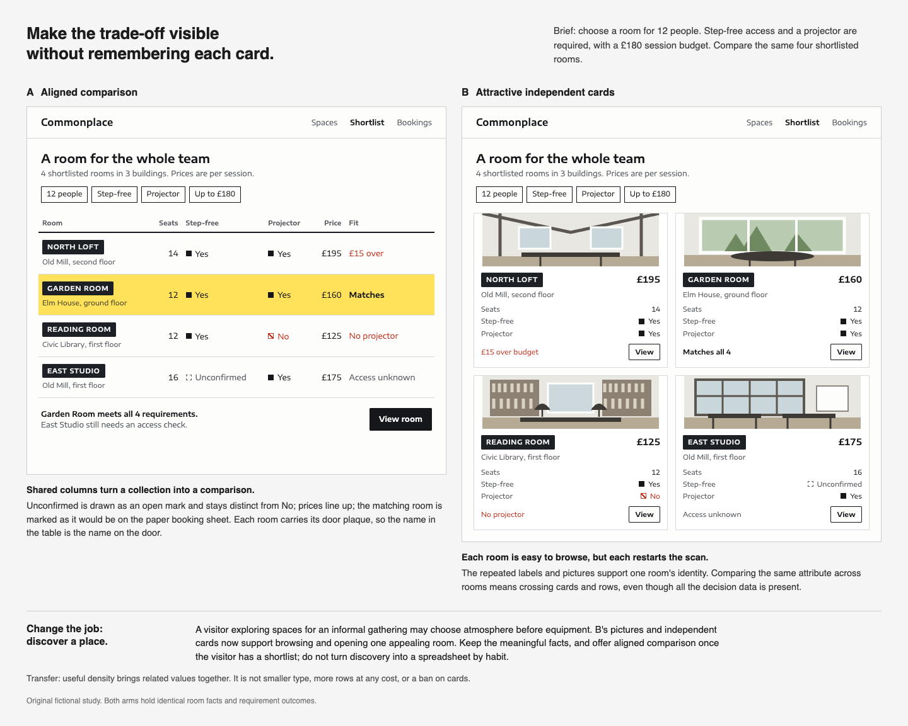
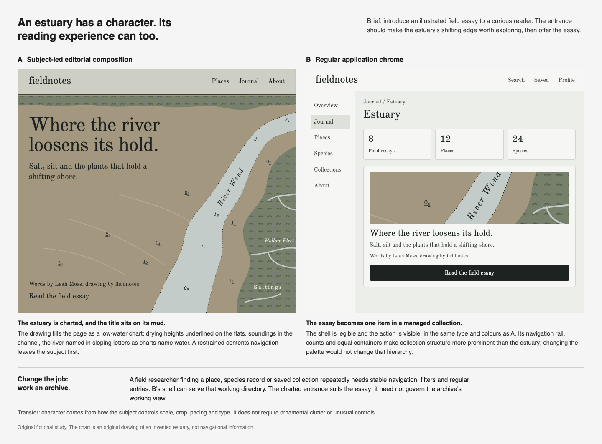
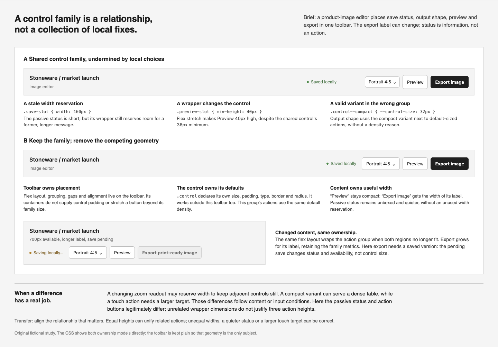

# Composition contrasts

Open these studies when the page has all its pieces but their arrangement
makes the wrong thing important, when cards hide a comparison, when a subject
disappears behind application chrome, when a toolbar is being repaired with
one-off dimensions, or when a page is competent but could belong to any
subject. They illustrate choices, not a house style or a review sequence.

The [self-contained study source](../assets/visual-studies/composition-studies.html) contains
five original fictional briefs, alternative compositions and the context in
which each alternative becomes useful. It uses only HTML, CSS, inline SVG,
system fonts and the open-licence fonts bundled beside it; the controls depict
states rather than performing actions. Each product takes its look from its
own subject, and both arms of a pair keep that look, so each pair isolates a
difference of composition, not of skin. The frame around the plates is
deliberately plain. The PNGs below let an image-capable reader inspect the
visual relationships without first rendering the source. Text and source
remain available for readers that cannot inspect images.

## Creation entrance or configuration inventory

For a ceramics maker producing a product image, the prompt, attached reference
and output shape explain the first useful action. A capability-first form can
be well laid out and still foreground decisions that maker need not make.
The same persistent parameters become useful in a model lab, where holding the
seed and dimensions constant is part of the work. The distinction is which
decision deserves the entrance, not whether settings should exist.

Stillroom's look comes from the ceramics workshop it serves: raw clay grey for the
ground, pencil on bisque for labels, and the dark tenmoku glaze for the one
action that makes the image. The suggested scenes are drawn as test tiles,
half raw and half glazed, because a test tile is how a potter sees a result
before committing to it. In the inventory the same identity rules the
parameters like a kiln log.

## Aligned comparison or independent cards

The shortlist asks for relationships: which room seats twelve, has step-free
access and a projector, and fits the budget? Shared columns make those values
comparable without retaining another card's details. The table keeps
“Unconfirmed” different from “No” and labels each failed condition. It is
denser where the comparison benefits, not filled to capacity.

The cards retain the same facts and outcomes. They support independent
browsing and atmosphere; they cost more cross-card scanning for the stated
shortlist decision. When the task changes to discovering an appealing place,
their imagery and separate identity can earn that cost.

Commonplace takes its look from the buildings' own signage and paperwork. Each
room name is set as its engraved door plaque in a wide grotesque, so the name
in the list is the name on the door; the matching room is marked as a
highlighter marks the paper booking sheet; and yes, no and unconfirmed are
drawn as a filled, a crossed and an open mark, so an unknown cannot be read as
a refusal.

## Subject-led editorial composition or regular application chrome

The expressive entrance gives the page to its subject: an estuary charted at
low water, with drying heights underlined on the flats, soundings in the
channel and the river named in sloping letters, as charts name water. The
essay's title sits on the mud. Its classical text serif comes from that chart
lettering, and the colours are the chart's mud, saltmarsh and channel. The
alternative uses the same type and colours and is competent application
structure, but its rail, counts and containers tell the reader that collection
management is the main job. Different accent colours would not reverse those
priorities.

For a researcher repeatedly finding species, places and saved records, regular
chrome can instead be the right choice. An archive working view and an essay
entrance need not share one composition merely because they share a product.

## Shared control family

Both toolbars use the same control family. In the first, the passive status
wrapper retains a fixed width for a former, longer message; a wrapper's
minimum height stretches Preview beyond the family minimum; and output shape
uses the smaller named variant beside default-sized actions without a density
reason. The components are shared, but their geometry has competing owners.

The repair keeps the family and removes those local conflicts. The toolbar
owns placement and grouping. The control itself declares reusable size,
padding, type, border and radius defaults, so it remains correct outside the
toolbar. Content determines intrinsic width. A compact variant remains useful
for an actually denser setting; its existence does not justify choosing it
for one arbitrary control in this group.

Status remains visibly different from an action. Related buttons share a height
and padding rule but not identical widths. The narrower composition keeps the
full export label and wraps the action group to another row using the same
layout. A pending save changes status and export availability, not the family's
geometry; in this fictional editor, export needs a saved version. A fixed
numeric readout can legitimately reserve width to prevent movement, and a touch
action can need a larger target. The transferable idea is ownership of
geometry, not equal pixels everywhere. [Visual system](visual-system.md)
develops the broader component and composition reasoning. This plate is drawn
plainly in system type, so that geometry is its only subject.

## A familiar look or a direction from the subject

Both arms carry one small sound-system label's catalogue: the same twelve
releases, format filter and record now playing, in the same order of
importance. Arm A is a familiar look made well: a near-black ground with one
acid or neon accent, monospace labels and a grid of square covers. Nothing in
it is broken, and the hierarchy is clear, yet every element would have arrived
for an unrelated label, or for a podcast.

Arm B starts from the label's own printed matter and keeps three of its
particulars: the flat colour of each sleeve, the wood-type capitals of its
dance posters, and the seven-inch label itself, its text set in the round about
the spindle hole and its catalogue number rubber-stamped as on a pre-release.
The ground takes the sleeve colour of the record now playing; the name fills
the measure edge to edge, as a poster printer fits each line to it, and its
size follows the measure at any width; each release is drawn as its label. A
subject this loud can be loud throughout as long as one thing leads; here the
poster-sized name leads and the labels carry its type into every release. Heavy
condensed capitals on a flat saturated ground are also what arrives when a page
is merely asked to be bold; here the posters and labels ask for them, and the
page can name where each choice came from.

Arm A becomes the right choice when the sleeves are the identity. A label that
releases mostly digitally, each record with its own commissioned square
artwork, has made the artwork its subject: a quiet dark ground and a grid of
square covers let every sleeve speak, and drawn labels would hide the work the
label paid for. The same holds when a label already owns A's look; it is then
the direction, followed exactly.

## Source and rendering

All five studies, names, datasets and drawings were created for this package.
They are not screenshots of real products, copied designs, performance
measurements or evidence of user preference. The record label, its artists
and releases are invented, and the estuary chart is not navigational
information.

The frame and the toolbar plate use system fonts. The products use five
open-licence families bundled in `assets/visual-studies/fonts/`. Each file is
byte-for-byte as published in [google/fonts](https://github.com/google/fonts)
at commit `5e8a3ba899557829a76cfdac30fa512bda91d7ca`, under the SIL Open Font
License 1.1; each family's licence is in `assets/visual-studies/licenses/`.
Two files are renamed and otherwise unchanged.

| Family | Product | Bundled file | Source path at that commit | Licence |
| --- | --- | --- | --- | --- |
| Alegreya Sans | Stillroom | `AlegreyaSans-Regular.ttf`, `AlegreyaSans-Medium.ttf` | `ofl/alegreyasans/` (same names) | `AlegreyaSans-OFL.txt` |
| Encode Sans Expanded | Commonplace | `EncodeSansExpanded-Regular.ttf`, `EncodeSansExpanded-SemiBold.ttf` | `ofl/encodesansexpanded/` (same names) | `EncodeSansExpanded-OFL.txt` |
| Old Standard | fieldnotes | `OldStandard-Regular.ttf`, `OldStandard-Italic.ttf` | `ofl/oldstandardtt/` (same names) | `OldStandard-OFL.txt` |
| Anton | Furnace Row, arm B | `Anton.ttf` | `ofl/anton/Anton-Regular.ttf` | `Anton-OFL.txt` |
| League Gothic | Furnace Row, arm B | `LeagueGothic.ttf` | `ofl/leaguegothic/LeagueGothic[wdth].ttf` | `LeagueGothic-OFL.txt` |

Each PNG is a browser capture of one matching `<section class="study">` in the
HTML source, at its authored width of 1440 CSS pixels and device scale factor
1. The plates are fixed-width teaching images with no narrow composition, so
there are no narrow captures. Open the source locally in a browser with a
viewport at least 1472 CSS pixels wide, wait for `document.fonts.ready`, and
capture `#creation`, `#comparison`, `#editorial`, `#toolbar` or `#identity`
without scaling the element, with animations stopped so the record in the
identity plate's player stands still. The bundled faces render alike across
machines; the system fonts in the frame and the toolbar can vary. Keep a
revised PNG paired with its revised source so the picture and its explanation
continue to teach the same contrast.
