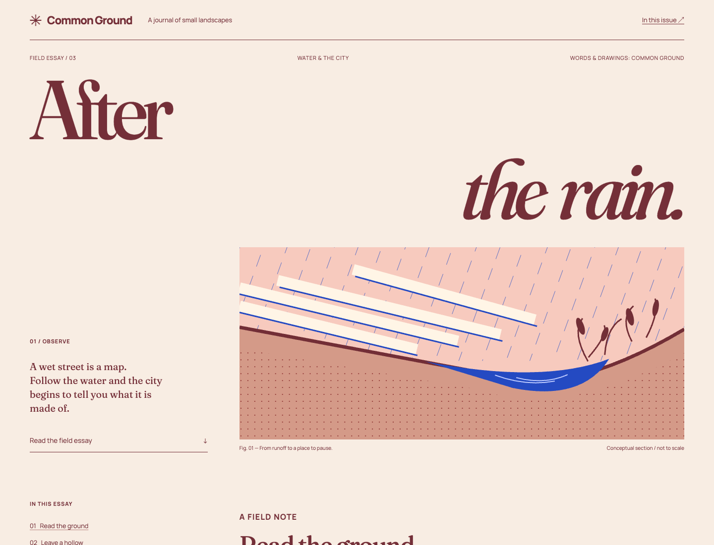
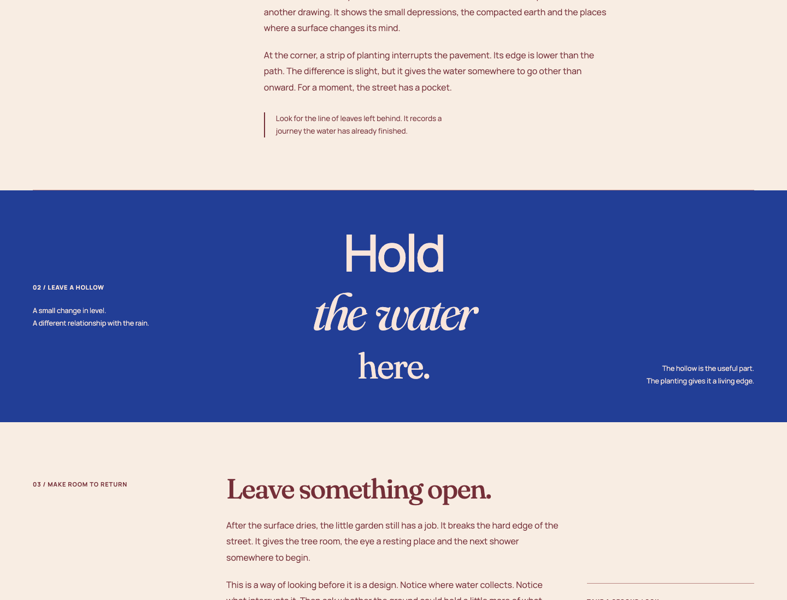
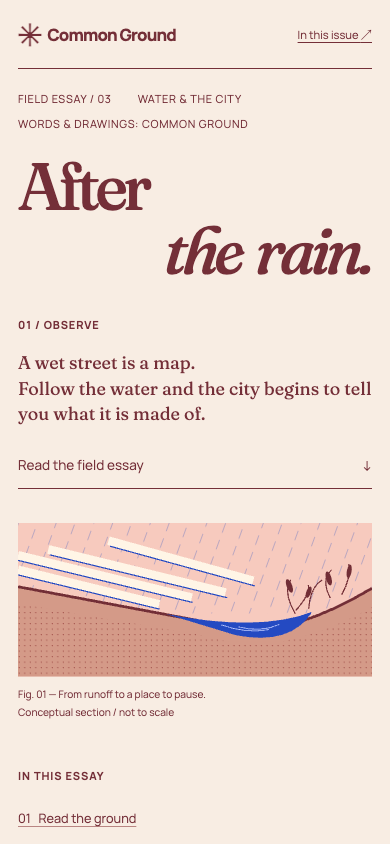
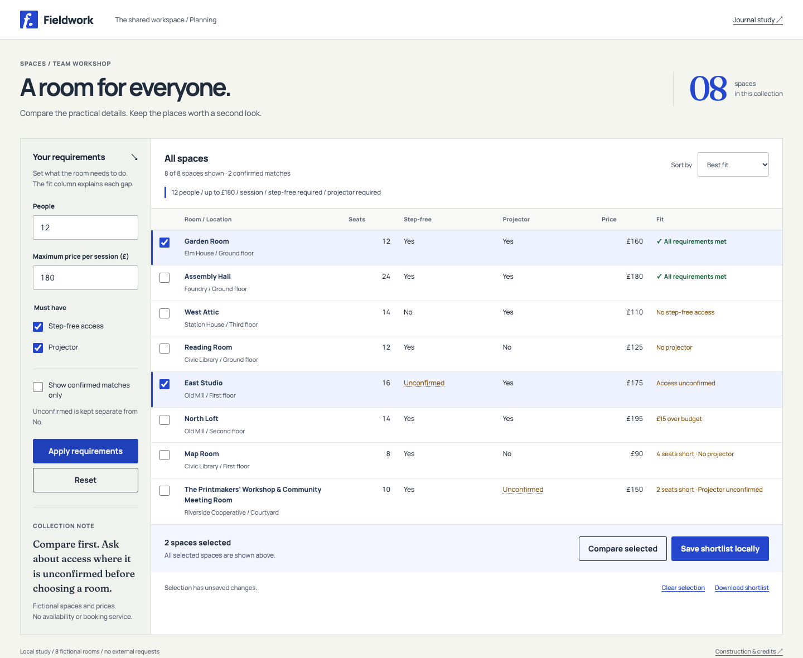
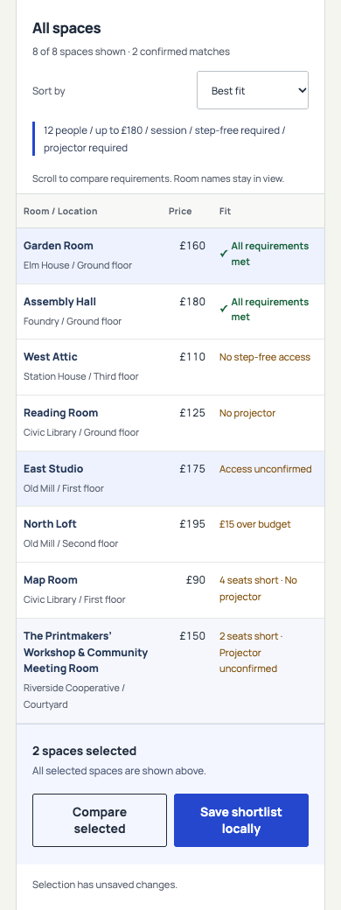

# Compositions you can take apart

Use these resources when information is already in the right place but type,
image, rhythm and interaction do not yet form a convincing whole. They are
two implemented fictional products, not a common shell with different colors.
The [four composition contrasts](composition-contrasts.md) still own the
creation/configuration, comparison/browsing, editorial/archive and geometry
distinctions. These sources deepen how a chosen direction is made.

Open [Common Ground](../assets/working-compositions/editorial.html) to read an
essay and follow its in-page contents. Open
[Fieldwork](../assets/working-compositions/comparison.html) to set requirements,
compare eight rooms, select across filters and retain a shortlist. Both use
plain HTML/CSS/JavaScript and bundled fonts. A local static HTTP server gives
the comparison a consistent origin for URL history and browser storage;
opening the HTML directly still renders it, but `file:` storage varies by
browser. No build or package install is needed. Browser storage contains only
this fictional shortlist; downloading it creates a local JSON file.

## Common Ground: a page with a reading rhythm

The wide composition moves diagonally. The first title line begins at the
left, the second ends at the right, and the drawing continues that movement
through descending channels into a hollow. The left-hand note occupies the
space the drawing leaves open. That relationship, rather than title size
alone, makes water and ground the subject of the page.

Fraunces supplies a soft, uneven serif contour; Manrope keeps labels and
navigation precise. Roman and italic change the direction of the title
without adding a third family. The display tracking is tighter than the
body's, while explicit space between split words prevents the animated
letter spans from joining the words optically. A line cap stops the title
from growing indefinitely on a large display. The reading column instead has
a character-based maximum measure and loose line spacing: display drama does
not become paragraph typography.

The original SVG is a sectional drawing, not a thumbnail. Cropping channels
at its left edge suggests continuation outside the frame; a single saturated
blue area gathers the movement into the hollow. The same blue returns as a
full-width pause in the article. Warm paper, dark red type and blue water have
different jobs, so reducing this to one accent token would discard the
relationship. The drawing is conceptual, not engineering guidance.

The pause uses three type roles: a direct sans-serif verb, an italic object,
then a smaller serif landing. Side notes stay small enough to remain notes.
After it, the article returns to the original measure and a smaller heading.
Making every section a display title would remove that contrast; reducing
all sections to equal cards would remove the pacing.

At narrow widths the note and drawing become consecutive blocks, captions
split into lines, and the contents move ahead of the article. The title keeps
its two opposed lines, but the illustration no longer needs to share their
horizontal span. This is recomposition rather than scaling a desktop canvas.
A substantially different headline needs fresh line and measure choices;
the hand-set two-line arrangement is not an arbitrary-title template.

### Construction and adaptation

[HTML and original SVG](../assets/working-compositions/editorial.html),
[composition CSS](../assets/working-compositions/editorial.css) and
[motion source](../assets/working-compositions/editorial.js) are inspectable.
The `data-effect3` construction adapts Codrops' opposed lines and top-origin
vertical character expansion. The `data-effect10` construction adapts its
mixed-face three-line title and blur/opacity reveal.

The implementation changes the original scroll-driven effects to short,
one-time native Web Animations on entry. It starts from partial scale or
opacity rather than withholding the words, preserves an unsplit accessible
heading name, and leaves complete text visible without JavaScript. Reduced
motion keeps the composition still; replay is a separate action in the
colophon. The motion is an accent on an already-legible arrangement, not the
means by which the reader gains access to the article. This construction is
unsuitable for repeatedly refreshed data labels, where motion would compete
with detecting changed values.

## Fieldwork: identity inside a working comparison

Here the recurring rhythm is the row, not the section. Room and location share
one cell; capacities and prices align right with tabular figures; each fit
explanation sits on the same row as the facts that caused it. Long room names
wrap in their column instead of stretching the entire table. Unconfirmed is
a distinct value, not a false No or an eligible match.

Manrope carries most of the work. Fraunces is confined to the small mark,
collection number and side note, so there is a recognizable identity without
making data expressive at the expense of comparison. The blue selected-row
edge and checkbox mean selection; green check-marked text means a confirmed
fit. A room can be selected while failing a requirement. Combining those two
states into one green highlight would suggest a judgment the user never made.

Requirements are worth keeping visible here because varying them is the job.
The applied summary over the table records what its fit column currently
uses; editing the form does not silently change the results before Apply.
Sort, filtering and selection remain separate. Filtering can hide a selected
room, but the selection summary names that scope and comparison/save include
it. The native dialog compares all selected rooms and returns focus to its
trigger on dismissal.

The narrow composition moves requirements above the result and scrolls the
table, instead of turning rows into independent cards. The room identity
column remains at the left edge in both tables, so the far-right price and fit
still belong to a visible room. Its solid background and selected-row color
keep passing cells from showing through. The scroll region can receive
keyboard focus; focusing a selection checkbox brings that control back into
view. This preserves column relationships at the cost of horizontal travel;
a task centered on inspecting one room would justify a detail view instead.
The shortlist bar follows the table in normal flow so it cannot cover the
final row or a focused control.

[HTML](../assets/working-compositions/comparison.html),
[CSS](../assets/working-compositions/comparison.css) and
[data and behavior](../assets/working-compositions/comparison.js) are original.
The dataset deliberately includes a long room name, an unknown access value,
an unknown projector value, price gaps and capacity gaps. Saving is a real
local-storage write, not an animated pretend server operation. A failed write
keeps the selection and offers its JSON download. Another tab changing the
saved shortlist changes the saved baseline without replacing the current
selection. The browser Back button restores applied requirements and sort;
unsaved selection belongs to this page, while the last saved shortlist
survives reload. There is no availability, booking or network service.

## What is shared, and what is not

[Shared CSS](../assets/working-compositions/shared.css) owns the bundled font
faces, focus/skip treatment and the geometry of ordinary text-labelled
actions. The journal's Replay action and the comparator's Apply, Compare and
Save actions share that role. Palette is supplied by each composition.
Neither masthead, page grid, title treatment, checkbox, passive status nor
table row is forced into that action component. Shared geometry helps where
the relationship recurs; a universal page shell would erase the distinction
these examples are meant to make concrete.

## Sources, rights and limits

- Codrops, [OnScrollTypographyAnimations](https://github.com/codrops/OnScrollTypographyAnimations/tree/af28d61d1f8d3d117f5d1e9b09d5209e20a1a212),
  commit `af28d61d1f8d3d117f5d1e9b09d5209e20a1a212`: the two identified
  constructions in `src/index.html`, `src/css/base.css` and `src/js/index.js`
  are adapted under the bundled [MIT notice](../assets/working-compositions/licenses/Codrops-MIT.txt).
  Its poem, photographs, Adobe fonts, GSAP, Splitting, smooth-scrolling stack
  and analytics are not included. All journal wording, the SVG, page layout,
  responsive rules, comparator and data are original to these studies.
- [Fraunces](https://github.com/google/fonts/tree/5e8a3ba899557829a76cfdac30fa512bda91d7ca/ofl/fraunces)
  and [Manrope](https://github.com/google/fonts/tree/5e8a3ba899557829a76cfdac30fa512bda91d7ca/ofl/manrope)
  come from Google Fonts commit `5e8a3ba899557829a76cfdac30fa512bda91d7ca`.
  The bundled [Fraunces regular](../assets/working-compositions/fonts/Fraunces.ttf),
  [Fraunces italic](../assets/working-compositions/fonts/Fraunces-Italic.ttf)
  and [Manrope](../assets/working-compositions/fonts/Manrope.ttf) variable TTF
  files are byte-unmodified; only their filenames are simplified. Their
  respective [Fraunces OFL 1.1](../assets/working-compositions/licenses/Fraunces-OFL.txt)
  and [Manrope OFL 1.1](../assets/working-compositions/licenses/Manrope-OFL.txt)
  notices accompany them. There is no hosted-font dependency.
- The PNGs are browser captures of these sources, not screenshots of real
  products. Wide views use 1440 CSS pixels; narrow views use 390, at scale 1.
  The comparison captures show a selection, not a recommendation. They show
  composition, not keyboard behavior or motion. These authored resources
  supply construction knowledge; they do not establish user preference,
  accessibility conformance or improved agent behavior in a later task.
