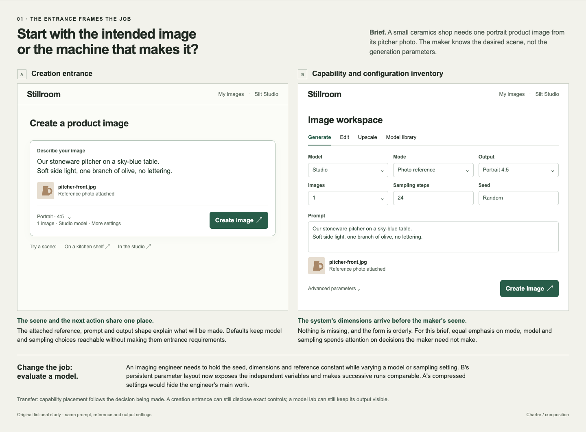
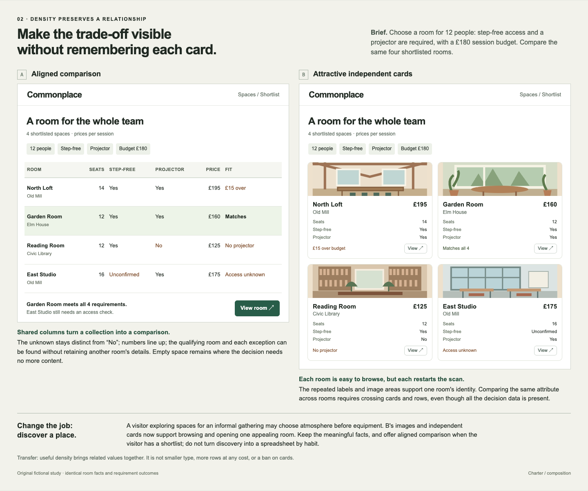
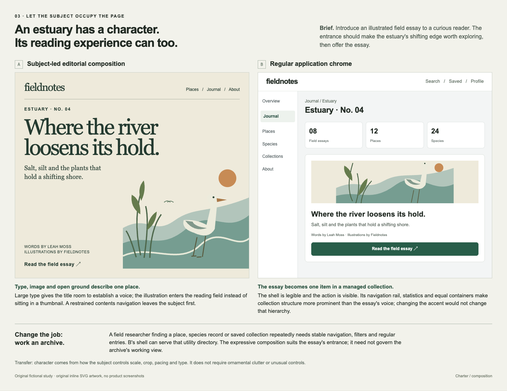
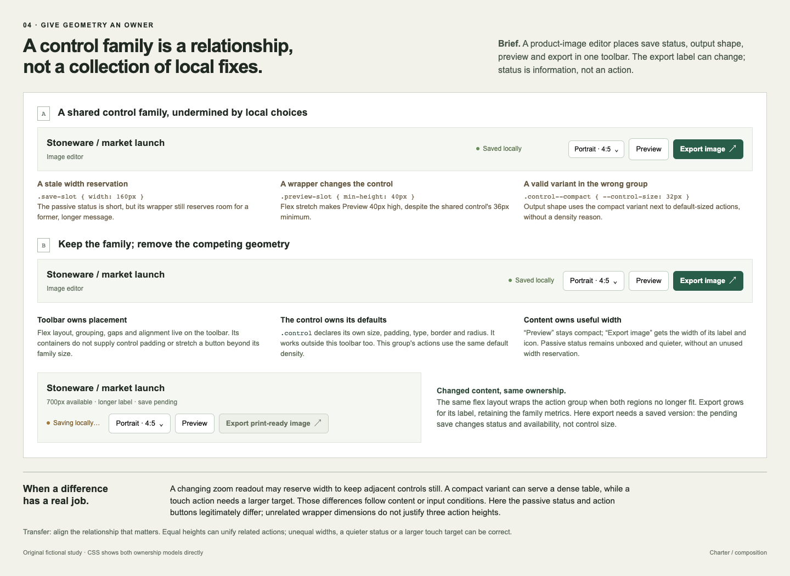

# Composition contrasts

Open these studies when the page has all its pieces but their arrangement
makes the wrong thing important, when cards hide a comparison, when a subject
disappears behind application chrome, or when a toolbar is being repaired with
one-off dimensions. They illustrate choices, not a house style or a review
sequence.

The [self-contained study source](../assets/visual-studies/composition-studies.html) contains
four original fictional briefs, alternative compositions and the context in
which each alternative becomes useful. It uses only HTML, CSS, inline SVG and
system fonts; the controls depict states rather than performing actions.
The PNGs below let an image-capable reader inspect the visual relationships
without first rendering the source. Text and source remain available for
readers that cannot inspect images.

## Creation entrance or configuration inventory

For a ceramics maker producing a product image, the prompt, attached reference
and output shape explain the first useful action. A capability-first form can
be well laid out and still foreground decisions that maker need not make.
The same persistent parameters become useful in a model lab, where holding the
seed and dimensions constant is part of the work. The distinction is which
decision deserves the entrance, not whether settings should exist.

## Aligned comparison or independent cards

The shortlist asks for relationships: which room seats twelve, has step-free
access and a projector, and fits the budget? Shared columns make those values
comparable without retaining another card's details. The table keeps
“Unconfirmed” different from “No” and labels each failed condition. It is
denser where the comparison benefits, not filled to capacity.

The cards retain the same facts and outcomes. They support independent
browsing and atmosphere; they cost more cross-card scanning for the stated
shortlist decision. When the task changes to discovering an appealing place,
their imagery and separate identity can earn that cost.

## Subject-led editorial composition or regular application chrome

The expressive entrance gives the essay's title and shoreline illustration the
page's scale and rhythm. The alternative is competent application structure,
but its rail, counts and containers tell the reader that collection management
is the main job. Different accent colours would not reverse those priorities.

For a researcher repeatedly finding species, places and saved records, regular
chrome can instead be the right choice. An archive working view and an essay
entrance need not share one composition merely because they share a product.

## Shared control family

Both toolbars use the same control family. In the first, the passive status
wrapper retains a fixed width for a former, longer message; a wrapper's
minimum height stretches Preview beyond the family minimum; and output shape
uses the smaller named variant beside default-sized actions without a density
reason. The components are shared, but their geometry has competing owners.

The repair keeps the family and removes those local conflicts. The toolbar
owns placement and grouping. The control itself declares reusable size,
padding, type, border and radius defaults, so it remains correct outside the
toolbar. Content determines intrinsic width. A compact variant remains useful
for an actually denser setting; its existence does not justify choosing it
for one arbitrary control in this group.

Status remains visibly different from an action. Related buttons share a
height and padding rule but not identical widths. The narrower composition
keeps the full export label and wraps the action group to another row using
the same layout. A pending save changes status and export availability, not
the family's geometry; in this fictional editor, export needs a saved version. A fixed
numeric readout can legitimately reserve width to prevent movement, and a
touch action can need a larger target. The transferable idea is ownership of
geometry, not equal pixels everywhere. [Visual system](visual-system.md)
develops the broader component and composition reasoning.

## Source and rendering

All four studies, names, datasets and vector illustrations were created for
this package. They are not screenshots of real products, copied designs,
performance measurements or evidence of user preference.

Each PNG is a browser capture of one matching `<section class="study">` in the
HTML source, at its authored width of 1440 CSS pixels and device scale factor
1. Open the source locally in a browser with a viewport at least 1472 CSS
pixels wide; capture `#creation`, `#comparison`, `#editorial` or `#toolbar`
without scaling the element. System-font rendering can vary across machines.
Keep a revised PNG paired with its revised source so the picture and its
explanation continue to teach the same contrast.
